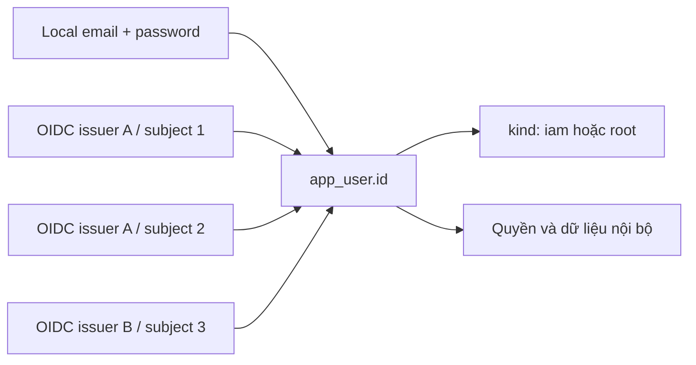

# Nghiên cứu liên kết tài khoản local và nhiều OIDC

Ngày: 2026-10-17 (nghiên cứu gốc từ base-auth), áp dụng cho HRM 2026-10-18. Trạng thái: nghiên cứu nguồn; runtime chưa triển khai. Đối chiếu source và ADR 0006/0012; không coi các mục trong kế hoạch cũ là tính năng đã có.

> **Áp dụng cho HRM (2026-10-18).** Tài liệu được chép từ base-auth; các ADR 0015–0017 (profile, step-up, lifecycle), `root-step-up-analysis.md`, `online-user-administration-analysis.md` và hai plan ngày 2026-10-17 mà bản gốc tham chiếu **không có trong HRM** (số 0015–0017 ở HRM là ADR khác). Quyết định của HRM theo nghiên cứu này: [ADR 0022](decisions/0022-root-step-up-and-time-source.md) (Root fresh theo policy action, nguồn thời gian DB/Day.js UTC) và [ADR 0023](decisions/0023-sign-in-methods-and-account-linking.md) (phương thức dùng được, mã tham chiếu binding, link theo bằng chứng **và** email trùng, Root email offline, màn hình "Phương thức đăng nhập"); cả hai Proposed. Đồng bộ profile hoãn. Đường dẫn `src/…`, `test/…` bên dưới tính từ `apps/api/` (ADR 0015 của HRM).

Bổ sung: nghiên cứu gốc đề xuất chỉ yêu cầu proof cho action nhạy cảm; HRM chốt hướng này ở ADR 0022. Quy tắc fresh-auth cho mọi write của Root trong ADR 0012 vẫn là semantics hiện hành cho đến khi ADR 0022 được duyệt và triển khai.

Yêu cầu OIDC: luôn yêu cầu `openid email profile`; mapping và đồng bộ thông tin account được mô tả tại [thiết kế OIDC claims/profile](oidc-claims-profile-design.md) (hoãn ở HRM). Source HRM **đã** gửi `openid email profile` (ADR 0020, `auth/services/product-oidc.service.ts#begin`) và dùng `email`/`email_verified` cho enrollment lần đầu và link; chưa lưu profile.

## 1. Hướng đề xuất

Giữ một `app_user.id` làm danh tính nội bộ ổn định. Password và các tài khoản OIDC là những phương thức đăng nhập vào user đó. Quyền, dữ liệu sở hữu, trạng thái suspended và `kind = iam/root` thuộc user nội bộ; không thuộc email hoặc provider.

Một user có thể local-only, OIDC-only, hoặc local + một/nhiều OIDC. Hai tài khoản tại cùng issuer cũng hợp lệ. Đăng nhập bằng bất kỳ phương thức được phép nào đều ra cùng user; liên kết hai OIDC không tự trở thành MFA.

Khóa external identity là `(issuer, subject)`, không phải email. Email ở các provider có thể khác nhau; email trùng hoặc `email_verified=true` không đủ để hợp nhất user. Đây là hệ quả từ quy tắc định danh của [OIDC Core §5.7](https://openid.net/specs/openid-connect-core-1_0.html#ClaimStability).

Không tạo password giả cho user OIDC-only, không bắt user OIDC-only có email, không tạo một user nội bộ mới cho mỗi provider khi đang thực hiện liên kết.

## 2. Những gì implementation hiện tại đã có

| Nội dung                       | Bằng chứng trong source                                                                                    | Kết luận                                                                                     |
| ------------------------------ | ---------------------------------------------------------------------------------------------------------- | -------------------------------------------------------------------------------------------- |
| User độc lập credentials       | `src/database/migrations/001-initial.migration.ts`: `app_user`, `local_credential`, `external_identity`    | Mô hình nền phù hợp, không cần thay bằng user-per-provider                                   |
| Nhiều external identities/user | PK `(issuer,subject)`; không có unique `(user_id,issuer)`; `ProductOidcService.callback` insert theo tuple | Schema và luồng link cho phép nhiều account, kể cả cùng issuer                               |
| Chế độ deployment              | `src/config/app.config.ts`: `AUTH_METHODS`, `localEnabled`, danh sách providers                            | Nhận `local`, `oidc`, `local,oidc`; tối đa 8 issuer, một client config/issuer                |
| Đăng nhập và liên kết OIDC     | `src/auth/services/product-oidc.service.ts`: `begin`, `callback`, `unlink`                                 | Có Code + PKCE, state/nonce/browser binding, kiểm provider version, proof và session binding |
| Thu hồi sau link/unlink        | Cùng service: tăng `auth_epoch`, gọi `invalidate`, audit trong transaction                                 | Session cũ mất hiệu lực; link hiện không cấp session thay thế                                |
| Không reset thành local        | `src/auth/services/product-identity.service.ts`: `requestPasswordReset`, `resetPassword`                   | Chỉ reset credential local đã tồn tại; OIDC-only không được tạo password qua reset           |
| Root local hoặc OIDC           | `src/authorization/services/product-manifest.service.ts`: `bootstrapProductRoot`; migration 012            | Bootstrap một Root pending, chọn local hoặc exact OIDC binding; kind độc lập phương thức     |

Đã đọc test tại `test/product-identity.integration-spec.ts`: có signed-token/PKCE/nonce, replay, không link bằng email, fresh reauthentication, link/unlink/relink, bảo vệ phương thức cuối và reset OIDC-only. Chưa chạy lại các test đó trong lần nghiên cứu này; ca nhiều binding đồng thời/cùng issuer cần được kiểm thử riêng trước khi công bố đầy đủ tính năng.

## 3. Ba lớp cần phân biệt

1. **Deployment cho phép gì:** trusted provider/client configuration và có bật local hay không.
2. **User được phép dùng gì:** chính sách đăng nhập của account, nếu sản phẩm cần hạn chế riêng từng account.
3. **User đã đăng ký gì:** local credential thực tế và các OIDC binding đã chứng minh quyền kiểm soát.

Phương thức dùng được phải thỏa cả ba lớp, đồng thời account active, credential/binding/provider đúng version và đáp ứng yêu cầu assurance. “Dùng được” ở đây là hợp lệ theo chính sách và cấu hình; không bảo đảm IdP luôn online. Không gọi thử IdP trong transaction để đếm phương thức.

Đề xuất làm bản đầu nhỏ: deployment quyết định tập phương thức, mỗi user sử dụng tập credentials đã đăng ký. User không có password là OIDC-only dù deployment bật cả hai. Chỉ thêm chính sách account bền vững khi cần diễn đạt “user này tuyệt đối không được thêm local”, hoặc “IAM chỉ OIDC nhưng Root được local”. Khi đó cần ADR và enforcement ở đăng nhập, session resolution, link/unlink, reset và add-password; chỉ ẩn nút trên UI không đủ.

Ví dụ cấu hình cho phép cả local và OIDC:

| Account | Credentials                    | Cách đăng nhập                                       |
| ------- | ------------------------------ | ---------------------------------------------------- |
| U1      | Local                          | Local                                                |
| U2      | OIDC A1, A2, B1                | Bất kỳ binding OIDC hợp lệ                           |
| U3      | Local, OIDC A1                 | Local hoặc OIDC A1                                   |
| Root    | Local hoặc OIDC, có thể cả hai | Theo cùng quy tắc, sau đó nhận kind Root từ database |

Nếu deployment là OIDC-only thì local Root cũng không đăng nhập được bằng password. Muốn Root local trong khi IAM OIDC-only phải thiết kế ngoại lệ account rõ ràng trên deployment hỗ trợ cả hai; không tự bật local khi IdP lỗi.

## 4. Luồng liên kết từ màn hình bảo mật

1. User đăng nhập vào account nội bộ đang sở hữu. Màn hình “Phương thức đăng nhập” hiển thị local đã bật/chưa có và danh sách các OIDC binding; mỗi binding có mã tham chiếu nội bộ, tên provider và nhãn để phân biệt account.
2. Yêu cầu xác thực lại bằng một phương thức **đã liên kết và còn được phép**. Với thay đổi identity, dùng thời hạn fresh theo ADR; kiểm thời hạn cuối cùng bằng DB clock trong transaction. Không cho account mới sắp link tự xác thực quyền sở hữu account cũ.
3. User chọn provider từ danh sách trusted do backend công bố. Tạo ceremony TTL ngắn, single-use, ràng buộc user, session hiện tại, browser, purpose, issuer/client/version, state, nonce và PKCE. Không nhận issuer/discovery URL tùy ý từ người dùng.
4. Chuyển sang IdP để chứng minh account mới. Hỗ trợ chọn account để tránh vô tình dùng lại SSO account cũ. Đề xuất yêu cầu xác thực mới cho thao tác link, kiểm `auth_time`; không xem riêng `prompt=select_account` là bằng chứng freshness. Ý nghĩa `prompt`, `max_age` và `auth_time` được định nghĩa tại [OIDC Core §3.1.2.1](https://openid.net/specs/openid-connect-core-1_0.html#AuthRequest).
5. Callback xác minh code/token và tạo proof link chờ xác nhận. Màn hình hiển thị account vừa chứng minh để user xác nhận rõ. Thiết kế luôn yêu cầu scope `openid email profile`, lấy và validate metadata theo tài liệu OIDC claims/profile. HRM đã gửi đủ ba scope; không được giả định provider luôn trả đủ email/name.
6. Commit chỉ sau khi xác nhận: kiểm lại session, freshness, auth epoch, policy, provider version, proof và tuple ownership trong exclusive fence. Không network hoặc hash password trong fence. Tuple đã thuộc user khác phải từ chối; không chuyển ownership hoặc gộp dữ liệu.
7. Ghi binding/version, tăng epoch, thu hồi session/proof cũ và ghi audit cùng transaction. Giữ hành vi bảo thủ hiện tại: hoàn tất rồi yêu cầu đăng nhập lại. HTTP/UI cần xóa cookie session đã vô hiệu và đưa user đến màn hình đăng nhập có thông báo thành công.

Việc chứng minh cả account hiện hữu và account mới cũng là hướng dẫn của [Auth0 về account linking](https://auth0.com/docs/manage-users/user-accounts/user-account-linking/link-user-accounts); đây là nguyên tắc tham khảo, không đề xuất phụ thuộc Auth0.

Code hiện đã có nhiều kiểm tra ở các bước trên nhưng callback đang link ngay, chưa có bước xác nhận cuối, và link chưa yêu cầu freshness của account IdP mới. HRM còn yêu cầu email IdP đã verified bằng email tài khoản (ADR 0020) — giữ quy tắc này theo ADR 0023. Cần ADR/contract cho phần mở rộng; không mô tả chúng là bảo vệ đã triển khai.

## 5. Gỡ liên kết và thay phương thức

Gỡ OIDC yêu cầu reauthentication và phải còn ít nhất một phương thức **thực sự được phép sử dụng sau mutation**. Đề xuất user chứng minh phương thức sẽ giữ lại trước khi gỡ phương thức hiện tại; đặc biệt hữu ích với Root. Với local giữ lại, phải có email login đã xác minh, credential hợp lệ và local được phép. Với OIDC giữ lại, binding/provider phải enabled, version và trusted runtime config phù hợp.

Giữ binding đã disable và tăng version như code hiện tại để không tự chuyển một tuple lịch sử sang user khác. Liên kết lại chỉ cho cùng user sau proof mới. Account merge giữa hai user nội bộ là bài toán riêng về ownership/quyền/dữ liệu và nằm ngoài đề xuất này.

Để chuyển từ local sang OIDC-only: link và đăng nhập thử OIDC thành công trước, sau đó mới tắt local theo policy đã chấp nhận. Chiều ngược lại cần operation “Thêm mật khẩu” riêng: fresh proof từ OIDC hiện hữu, quyền thêm local theo policy, xác minh địa chỉ local và token đúng purpose, kiểm unique email, hash ngoài fence, rồi commit credential + epoch/revoke/audit. Không dùng reset-password để tạo credential đầu tiên. “Xóa/tắt local” cũng là operation riêng, áp dụng cùng invariant phương thức cuối.

Thêm/xóa credentials không thay `kind`, IAM roles, ownership hoặc tự đồng bộ quyền từ OIDC claims. Admin tạo user có thể mời enrollment; admin không đặt password mình biết hoặc tự link account IdP của mình vào user khác.

## 6. Root và khôi phục

Giữ tối đa một Root nội bộ theo ADR 0012. Không tạo “Root local” và “Root OIDC” thành hai account đặc quyền. Mọi binding hợp lệ của Root đều đưa tới cùng Root; vì vậy thêm một binding là thay đổi quyền truy cập Root, cần cùng proof/freshness/audit và thu hồi như trên.

Root khởi đầu bằng local có thể tự link OIDC; Root khởi đầu bằng OIDC không cần password. Bootstrap Root ban đầu và khôi phục khi mất toàn bộ phương thức vẫn đi qua quy trình offline theo thiết kế hiện hành. UI self-service không thay đổi marker bootstrap hoặc cho tạo Root thứ hai. Nếu muốn bootstrap Root đầu tiên qua màn hình thì đó là quyết định riêng, cần ADR và cơ chế enrollment ban đầu; không suy ra từ nhu cầu link account.

OIDC cho Root chuyển một phần niềm tin sang IdP: người có khả năng chiếm/reset account tại IdP có thể đăng nhập vào Root. Khuyến nghị chọn IdP có chính sách MFA phù hợp và khai báo mapping assurance được tin cậy theo issuer. Đây là khuyến nghị triển khai; local MFA/WebAuthn/TOTP chưa được coi là tính năng hiện có.

Khi mất IdP hoặc mất password, dùng phương thức khác đã đăng ký và được phép. Không auto-create local credential, không tự cấp Root mới, không mở endpoint bypass để khôi phục. Với yêu cầu OIDC-only nghiêm ngặt, chấp nhận IdP outage làm ngừng đăng nhập và chuẩn bị runbook khôi phục có xác minh độc lập.

## 7. Khoảng trống cụ thể cần giải quyết trước triển khai UI

Các mục dưới là quan sát source và tác động suy ra; chưa có ca tái hiện mới trong lần nghiên cứu này.

| Vị trí / điều kiện                                                                 | Quan sát và tác động                                                                                                                         | Hướng xử lý                                                                                                                                                          |
| ---------------------------------------------------------------------------------- | -------------------------------------------------------------------------------------------------------------------------------------------- | -------------------------------------------------------------------------------------------------------------------------------------------------------------------- |
| `ProductOidcService.unlink`, khi local đã tắt nhưng credential còn tồn tại         | SQL `EXISTS(local_credential)` vẫn tính local là phương thức dự phòng. Gỡ OIDC cuối có thể làm user không còn cách đăng nhập được phép       | Dùng cùng phép kiểm effective methods ở unlink và chuyển policy, có regression test OIDC-only + credential lịch sử                                                   |
| `resolveSessionKindBody` trong migration 012, khi chuyển deployment sang OIDC-only | Session local xét state/epoch/credential version/email nhưng không biết `AUTH_METHODS`. Đổi env tự nó không thu hồi session local            | Chốt semantics cutover trong ADR; thu hồi có kiểm soát và bảo đảm mọi nơi resolve session cùng kiểm policy bền vững nếu hỗ trợ đổi online                            |
| `ProductRuntime.onApplicationBootstrap`, khi bỏ/thay provider                      | Provider enabled trong DB nhưng vắng config làm boot fail; version drift cũng fail. Đây là chặn có chủ ý, không phải cơ chế migrate user     | Cần preflight/release/runbook chuyển provider; không hướng dẫn chỉ sửa env rồi restart                                                                               |
| `ProductOidcService.begin/callback/unlink`                                         | Freshness link/unlink dùng `Date.now()`; link mới không yêu cầu `auth_time`; reauth OIDC chỉ yêu cầu cùng user, có thể đổi sang binding khác | Dùng DB clock cho quyết định cuối; chốt rõ reauth bằng binding hiện tại hay bất kỳ binding đã liên kết; đề xuất cho phép binding khác với proof rõ và policy phù hợp |
| `ProductIdentityService`, user OIDC-only muốn thêm local hoặc tắt local            | Chưa có operation add-password/remove-local; change/reset cần credential cũ                                                                  | Thiết kế capability riêng, proof và invariant phương thức cuối; không tái dùng reset sai purpose                                                                     |
| Auth HTTP port/controllers                                                         | Chưa có projection danh sách phương thức/provider cho màn hình quản lý; callback link không cấp session mới                                  | Thêm contract tối thiểu cho UI, binding reference không chứa token, thông báo logout sau mutation; không lộ client secret/claim thừa                                 |

Khi đổi mode/provider, preflight phải kiểm mọi account bị ảnh hưởng, gồm Root; hướng dẫn đăng ký phương thức thay thế, hoàn tất proof rồi mới cutover/revoke. Các instance chạy đồng thời không được dùng các policy mâu thuẫn. Nếu chưa có kế hoạch chuyển toàn bộ account thì từ chối cutover hoặc ghi nhận tài khoản sẽ bị khóa qua quy trình có chủ đích; không âm thầm fallback.

## 8. Phạm vi nên làm tiếp

1. Viết ADR bổ sung cho ADR 0006/0012: effective methods, reauth, link confirmation, add/remove local, chuyển policy/session và Root. Chốt liệu có cần hạn chế riêng từng account hay chỉ deployment + credentials.
2. Hoàn thiện invariants backend trước UI: đếm phương thức dùng được, DB-clock freshness, ràng buộc proof/confirmation, thu hồi/cookie, giới hạn số binding và attempts với kiểm tra atomic. Giữ schema hiện hữu nếu đủ; không xây identity broker mới.
3. Thêm API projection và màn hình “Phương thức đăng nhập”: phân biệt provider với từng account, xác nhận trước mutation, thông báo phải đăng nhập lại và lý do không thể gỡ phương thức cuối.
4. Kiểm thử PostgreSQL/concurrency và OIDC fixtures: hai binding cùng issuer, nhiều issuer, tranh chấp tuple giữa hai user, link/unlink đồng thời, stale proof/replay, provider/policy đổi giữa begin và callback, suspend/revoke trong lúc exchange, local bị tắt, Root local/OIDC, rollback audit và phương thức cuối. Fixture pass không chứng nhận IdP thật; cần thử interoperability với từng provider sử dụng.

Với nhiều provider, kiểm cả cơ chế chống mix-up theo [RFC 9700 §4.4.2](https://www.rfc-editor.org/rfc/rfc9700.html#section-4.4.2), khớp khả năng issuer identification của provider/library; không mặc định chỉ có state là đủ.

Khi thêm web/mobile/desktop, giữ mapping user ở API. Nếu sau này dùng nhiều OIDC client trực tiếp, phải đánh giá pairwise subject: `sub` có thể khác theo sector/client. Không nối chúng bằng email; cần proof/migration rõ ràng. Quy tắc subject types nằm trong [OIDC Core §8](https://openid.net/specs/openid-connect-core-1_0.html#SubjectIDTypes). Luồng browser-cookie hiện tại không tự chứng minh đã hỗ trợ native clients.

## 9. Nguồn nội bộ

- [ADR 0006: local và IdP](decisions/0006-single-product-local-and-idp.md).
- [ADR 0012: Root ngoài IAM](decisions/0012-iam-root-separation.md).
- [Kiến trúc single-product, mục authentication](authz-single-product-architecture.md).
- Phân tích quản trị user qua màn hình (bản base-auth, không có trong HRM); ở HRM xem [ADR 0020](decisions/0020-oidc-email-provisioning.md) — enrollment không thay thế proof account linking.

Chỉ bổ sung tài liệu nghiên cứu; chưa đổi schema, endpoint, env hoặc semantics đăng nhập. Runtime tests chưa được chạy lại cho tài liệu này.
