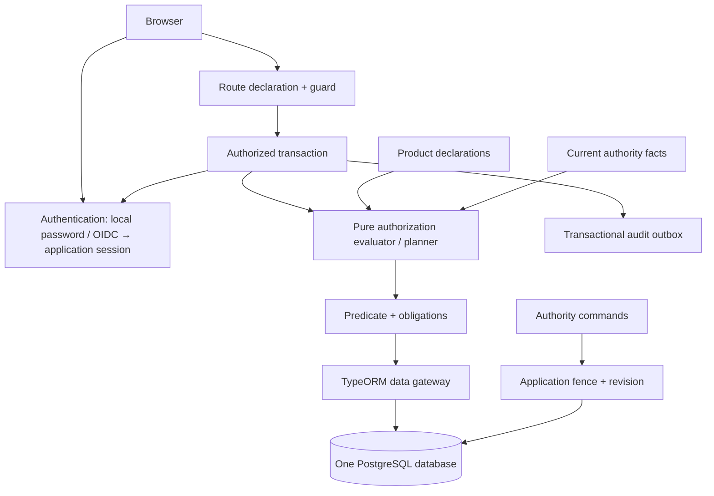

# Kiến trúc xác thực và phân quyền cho một sản phẩm

> Cập nhật implementation 2026-10-13: runtime API mới theo [kế hoạch chuyển đổi](superpowers/plans/2026-10-13-single-product-transition.md) và ADR0008. Các trạng thái/spike tenant hoặc “chưa triển khai” trong bản thiết kế gốc bên dưới là lịch sử, không chứng nhận hay phủ nhận trạng thái runtime mới. Xem ledger chuyển đổi để biết bằng chứng và gates còn lại.

Ngày: 2026-10-13. Trạng thái: phiên bản thiết kế thay thế, chưa triển khai. Stack: NestJS, TypeORM, PostgreSQL, pnpm; kế thừa phiên bản dependency đã khóa của dự án khi bắt đầu triển khai.

Đây là một phương án riêng với [kiến trúc multi-tenant](authz-architecture.md), không phải flag để tắt tenant checks của runtime hiện tại. Người dùng yêu cầu một sản phẩm, phân quyền nghiêm ngặt và đăng nhập nội bộ, không bắt buộc IdP. Tài liệu này không tuyên bố các test hiện tại đã chứng minh bản thiết kế mới.

## 1. Tóm tắt quyết định

Một NestJS modular monolith, một PostgreSQL database. User là danh tính trong sản phẩm; không có tenant, membership, tenant routing hay database-per-tenant. Phòng ban, nhóm, khu vực là resource/quan hệ nghiệp vụ, không giả lập tenant.

Hỗ trợ hai phương thức xác thực: email/mật khẩu nội bộ và IdP qua OIDC. Có thể bật local, OIDC hoặc đồng thời cả hai; IdP không bắt buộc khi chỉ bật local. Cả hai ánh xạ về cùng user nội bộ và phát opaque application session; mọi quyền do cùng authorization engine quyết định. JWT của IdP chỉ dùng trong luồng xác thực, không thay session hoặc chứa nguồn quyền được tin trực tiếp.

Giữ RBAC, direct allow/deny, phạm vi bản ghi qua ReBAC/ABAC, permission policy, permission boundary và record exception. Lõi đánh giá vẫn thuần; chỉ cần một SQL compiler PostgreSQL và bindings cụ thể của sản phẩm. Không xây SDK cho nhiều DB/ORM.

```text
Allow = ValidUserAndSession
        AND HardAdministrativeInvariants
        AND PermissionPolicy
        AND UserPermissionBoundary
        AND (RoleAllow OR DirectAllow OR RecordAllow)
        AND NOT AnyDeny
```

Với IAM principals, không role nào có quyền bỏ qua công thức và không có rank. Root là account `kind = root` ngoài IAM, bypass phân quyền qua `planUnrestricted` nhưng vẫn cần session hợp lệ, fresh-auth khi policy của action có `fresh@1` (ADR 0022) và audit (ADR 0012). Thỏa mãn policy/boundary không tự cấp quyền. Không có quyền mới nếu endpoint hoặc resource thiếu khai báo.

Bản đầu không cache quyết định allow; session và authority facts đọc từ primary. Một application fence đồng bộ thao tác dữ liệu với thay đổi quyền. Thu hồi có hiệu lực đối với authorization bắt đầu sau commit; không thu hồi được dữ liệu đã gửi.

## 2. Phần bỏ, phần giữ và giới hạn

| Thành phần                                  | Phiên bản một sản phẩm                                                             |
| ------------------------------------------- | ---------------------------------------------------------------------------------- |
| Tenant/tenant hierarchy/membership          | Bỏ; `user_role`, `user_boundary`, trạng thái user thay membership                  |
| Tenant directory/provisioning/pool registry | Bỏ; cấu hình một DB, pools cố định theo mục đích/quyền DB                          |
| Identity database riêng, OIDC bắt buộc      | Bỏ; credential/session nằm cùng DB nhưng truy cập bằng module/DB role chuyên trách |
| MySQL, nhiều ORM, plugin domain             | Bỏ khỏi phạm vi; TypeORM/PostgreSQL là adapter duy nhất                            |
| RBAC + ReBAC + ABAC + policy + boundary     | Giữ vì xử lý các ràng buộc khác nhau; cùng typed AST                               |
| SQL filter/list-detail consistency          | Giữ; guard HTTP không đủ                                                           |
| Fence, revision, audit, manifest            | Giữ nhưng chỉ một phạm vi application                                              |
| Ba domain demo/conformance SDK              | Thay bằng fixture nghiệp vụ thật và suite bảo mật chung của sản phẩm               |
| API keys, machine identity, emergency       | Không bật mặc định; có yêu cầu mới thì bổ sung contract/test riêng                 |

Không có tenant không có nghĩa mọi user được xem mọi dữ liệu. Truy cập record vẫn phải qua phạm vi và field projection. Tuy nhiên không còn cam kết cô lập khách hàng ở mức database: nếu sau này bán cùng installation cho các tổ chức cần cô lập độc lập, phải đánh giá lại kiến trúc.

## 3. Module và ranh giới tin cậy



Cấu trúc source một app sau chuyển đổi 2026-10-16 ([ADR 0013](decisions/0013-single-app-modules.md)); import implementation trực tiếp, không SDK/package nội bộ:

```text
apps/api/src/
  auth/
    controllers/   # HTTP và session cookie/CSRF
    services/      # Password/session/recovery và OIDC
  authorization/
    core/          # Pure types, validation, planner, evaluator
    values/        # Strict codecs
    enforcement/   # Nest decorators, route inventory và guard
    services/      # Authority và manifest sync
    helpers/       # Shared release validation, drift hashes, obligations
    product-sql.compiler.ts
    product-data.gateway.ts
    product.manifest.ts
  administration/  # HTTP/declarations quản trị
  document/        # Nghiệp vụ, declarations/bindings và migration ứng dụng
  database/        # Fixed-purpose transaction runner, probes/config, migrations
  audit/           # Atomic writer và outbox delivery
  health/          # Readiness, metrics
  infrastructure/  # Runtime composition, HTTP security/error mapping
```

Các package private đã được thay bằng module trong app; không tạo interface/port cho mọi service/repository. Core không import Nest/TypeORM/SQL; HTTP handlers không truy cập credential repository hoặc authority writer. Services dùng TypeORM trực tiếp theo trách nhiệm. Capability facades giới hạn operations của handler vẫn giữ; ESLint/tests kiểm ranh giới nội bộ, không phải process isolation. Bằng chứng từng check nằm trong [kế hoạch chuyển đổi](superpowers/plans/2026-10-16-single-app-modules.md).

Một DB không đồng nghĩa một connection với mọi quyền. Có các DB role giới hạn: data, identity, authority, manifest-sync và migration; mỗi role cần pool/DataSource riêng nếu ứng dụng sử dụng credential riêng. Không còn tạo pool theo tenant. Manifest-sync chỉ được inject vào bootstrap/CLI; migration credential chỉ ở deploy tooling. Đây là phân quyền tối thiểu trong cùng tiến trình, không phải sandbox chống tiến trình Node bị chiếm hoàn toàn.

## 4. Xác thực nội bộ và IdP

### 4.1 Tài khoản và mật khẩu

Profile ban đầu: email là login identifier, invitation-only; không có public signup. Tên hiển thị độc lập với email. Sản phẩm quy định email login không phân biệt hoa/thường và tạo `email_canonical` duy nhất; không áp quy tắc bỏ dấu chấm/`+tag` của từng nhà cung cấp. Việc đổi quy tắc canonicalization cần migration kiểm tra collision.

Hash mật khẩu bằng Argon2id qua thư viện được duy trì; không tự viết thuật toán. Mốc tối thiểu tham chiếu: memory 19 MiB, iterations 2, parallelism 1; benchmark rồi tăng cost phù hợp. Lưu encoded hash có salt và parameters để rehash dần; không lưu plaintext hoặc password có thể giải mã. Nguồn: [OWASP Password Storage](https://cheatsheetseries.owasp.org/cheatsheets/Password_Storage_Cheat_Sheet.html).

Profile sản phẩm đề xuất: password 15–128 Unicode code points, có giới hạn byte đầu vào rõ ràng, cho phép khoảng trắng và paste/password manager; không trim, truncate hoặc tự normalize password. Chặn mật khẩu phổ biến/đã lộ bằng blocklist; không ép đổi theo chu kỳ nếu không có dấu hiệu compromise. Benchmark Argon2 trước production, giới hạn số verify song song để tránh làm cạn CPU/RAM. Tham khảo [OWASP Authentication](https://cheatsheetseries.owasp.org/cheatsheets/Authentication_Cheat_Sheet.html).

Luồng login:

1. Validate input và rate-limit theo IP + định danh login đã băm; trust proxy cấu hình theo ingress thực tế, không tin tùy ý `X-Forwarded-For`.
2. Đọc credential; verify Argon2 ngoài transaction/fence. Với tài khoản không tồn tại, dùng dummy hash hợp lệ cùng cost để tránh đường trả lời quá nhanh. Không hứa timing tuyệt đối bằng nhau.
3. Mở transaction, lấy shared application fence; đọc lại user status và `credential_version`. Nếu hash/version đã đổi từ lúc verify thì từ chối hoặc thử lại có giới hạn; không cấp session từ password cũ sau reset.
4. Tạo session mới bằng secret ngẫu nhiên, audit login thành công, commit rồi mới trả cookie. User chưa active hoặc chưa hoàn tất xác minh thì không có full session.
5. Login thất bại dùng cùng mã lỗi/thông điệp cho sai password, user không tồn tại hoặc bị vô hiệu hóa. Rate-limit có thời hạn và giới hạn toàn hệ thống; không khóa vĩnh viễn user chỉ vì người ngoài đoán sai.

Không giữ transaction khi hash password hoặc gọi email. Rate-limit phải dùng state chung giữa replicas, có thể bắt đầu bằng PostgreSQL với TTL/bucket; Redis chỉ bổ sung khi đo thấy cần. Kho rate-limit lỗi thì endpoint cấp/reset credential trả unavailable, không bỏ bảo vệ.

### 4.2 Session

Session secret sinh ngẫu nhiên 32 byte; DB lưu SHA-256 digest, không lưu bearer secret. Cookie đề xuất `__Host-session`, `Secure`, `HttpOnly`, `Path=/`, không `Domain`; `SameSite=Lax` cho frontend/API cùng site. Rotate session sau login/reauthentication thành công. Idle timeout tham chiếu 30 phút, absolute timeout 12 giờ; admin command cần reauthentication trong 5 phút. Đây là cấu hình đề xuất của sản phẩm, không phải yêu cầu phổ quát. Nguồn về cookie/session lifecycle: [OWASP Session Management](https://cheatsheetseries.owasp.org/cheatsheets/Session_Management_Cheat_Sheet.html).

Session lưu `user_id`, thời điểm tạo/hết hạn/hoạt động, `credential_version`, `reauthenticated_at`, assurance, authentication method, external identity reference nếu có và revoked state. Với OIDC, còn kiểm provider hiện enabled và binding chưa revoke; credential version đóng vai trò epoch thu hồi cục bộ cho cả hai phương thức. Không lưu bản sao roles/permissions làm nguồn quyết định. Mỗi authorized transaction kiểm lại session/user hiện tại; guard chỉ giúp reject sớm. Touch last-seen có thể giới hạn tần suất, chấp nhận expire sớm tương ứng, không kéo dài absolute expiry.

Browser mutation phải có CSRF token gắn session và kiểm Origin theo allowlist; login cũng cần chống login-CSRF. SameSite là lớp bổ sung, không thay CSRF. CORS chỉ cho origin cụ thể, không wildcard credentials. Nguồn: [OWASP CSRF Prevention](https://cheatsheetseries.owasp.org/cheatsheets/Cross-Site_Request_Forgery_Prevention_Cheat_Sheet.html).

Logout revoke session hiện tại dưới exclusive fence trước khi trả thành công; logout-all revoke mọi session của user. WebSocket phải recheck khi nhận lệnh và trước khi phát dữ liệu; job không được coi cookie/session tại thời điểm enqueue là quyền vĩnh viễn. Không dùng JWT stateless ở bản đầu để tránh thêm cơ chế thu hồi song song.

### 4.3 Đổi, quên mật khẩu và lời mời

Đổi mật khẩu yêu cầu current password/reauthentication, CSRF và kiểm user hiện tại. Reset dùng token ngẫu nhiên một lần, hạn đề xuất 15 phút; DB chỉ lưu digest, purpose, user, expiry, credential version tại lúc phát. Câu trả lời yêu cầu reset không tiết lộ tài khoản tồn tại. Reset thành công không tự đăng nhập, thu hồi session cũ và token khôi phục còn lại. Đây là cách áp dụng [OWASP Forgot Password](https://cheatsheetseries.owasp.org/cheatsheets/Forgot_Password_Cheat_Sheet.html).

Reset transaction: exclusive application fence → khóa user → khóa token; kiểm purpose/digest/expiry/unused/version → cập nhật hash đã tính ngoài transaction → tăng credential version → consume token, invalidate các token/session cũ → audit → commit. Hai lần dùng đồng thời chỉ một lần thành công. Không được re-enable user đang bị suspend khi đổi password.

Email chỉ gửi đến địa chỉ đã xác minh, URL từ cấu hình origin tin cậy, không xây bằng Host header. Không ghi token vào log, analytics hay Referer; reset page không có tài nguyên bên thứ ba. Gửi qua mail port sau commit. Nếu cần retry bền vững, notification outbox phải mã hóa payload chứa token, TTL ngắn, worker giải mã với key ngoài DB; không đưa token thô vào audit outbox. Email lỗi không được tạo session hoặc báo reset đã hoàn thành.

Invite dùng purpose riêng và token một lần, không phải mật khẩu tạm do admin biết. Role đề xuất trong invite phải được kiểm lại theo authority hiện tại của người mời khi activate; inviter mất quyền thì invitation không tự cấp quyền cũ. Không chuyển một user đã tồn tại sang credential mới qua invite. Admin không được đổi email đã xác minh, đặt password, xem reset token hay impersonate bằng quyền quản lý user.

### 4.4 MFA và recovery

Đăng nhập password-only được hỗ trợ. Permission policy có thể yêu cầu reauthentication hoặc MFA cục bộ cho hành động đặc biệt; không đồng nhất MFA với IdP. Nếu policy yêu cầu MFA nhưng module/chứng cứ MFA chưa có, action bị chặn, không giả assurance cao.

TOTP/WebAuthn là phần bổ sung khi sản phẩm yêu cầu, không mặc định triển khai cả hai. MFA recovery là luồng riêng, không tự tắt MFA khi reset password. Recovery tài khoản quản trị mất toàn bộ credential dùng runbook ngoài API với xác minh độc lập và audit; không có endpoint bypass toàn hệ thống.

### 4.5 IdP là một phương thức được hỗ trợ

Thu gọn loại bỏ tenancy và portability chưa cần thiết, không loại bỏ federation. Profile hỗ trợ `local`, `oidc`, `local+oidc`; boot chỉ đòi cấu hình của phương thức đã bật. Bật OIDC mà thiếu issuer/client/callback config phải fail readiness. Khi IdP lỗi, không tự bật password fallback cho user chưa được phép dùng local.

`LocalCredentialsAuthenticator` và `OidcAuthenticator` là hai adapter xác minh bằng chứng đăng nhập, trả kết quả nội bộ cho cùng session service. Core authorization chỉ thấy user/session/trusted assurance, không phụ thuộc provider. Không nhận kết quả xác minh tự khai trong request. Bản đầu hỗ trợ IdP tương thích OIDC; SAML là ngoài phạm vi, không tuyên bố hỗ trợ mọi protocol.

OIDC dùng Authorization Code Flow + PKCE S256, state và nonce gắn với login attempt/browser, callback URL cố định. Server kiểm chữ ký với key của issuer tin cậy, thuật toán allowlist, issuer, audience/azp, expiry và nonce; không lấy issuer/JWKS/redirect tùy ý từ token hoặc request. State phải tiêu thụ một lần và code exchange có deadline, ngoài transaction giữ fence. Nguồn: [OpenID Connect Core](https://openid.net/specs/openid-connect-core-1_0.html), [OAuth Security BCP](https://www.rfc-editor.org/rfc/rfc9700.html).

Một external identity được ánh xạ duy nhất bằng `(issuer, subject)` tới `app_user.id`; email chỉ là thuộc tính, không tự link kể cả khi `email_verified=true`. Callback chỉ tạo session cho binding/user đã active. User chưa có binding cần invitation hoặc luồng enrollment/link tường minh; không tự tạo user có quyền theo email domain hoặc provider group. Collision email/binding phải fail closed, không merge user ngầm.

Cập nhật [ADR 0027](decisions/0027-google-only-sign-in.md) §6–7: sản phẩm không còn link/unlink IdP (mỗi tài khoản một binding đang bật) và không xác thực lại bằng IdP; `fresh` chỉ từ 2FA ([ADR 0026](decisions/0026-totp-second-factor.md)). Đoạn dưới là thiết kế lịch sử. Link IdP yêu cầu session hiện tại được reauthenticate và bằng chứng mới từ IdP, ràng buộc cùng login attempt; transaction kiểm lại user/provider/version, UNIQUE `(issuer,subject)`, audit và tăng epoch/revoke sessions liên quan. Unlink hoặc thêm password cần kiểm account-login policy và reauthentication; không gỡ phương thức cuối cùng khiến user mất đường đăng nhập. User manager không được đổi binding để chiếm user. Tài khoản OIDC-only không được tạo local credential bằng forgot-password; việc thêm local password là capability riêng được cấp trước, không suy ra từ sở hữu email.

Sau token verification ngoài transaction, mở shared fence, đọc lại provider enabled state, binding và user epoch/status rồi mới cấp application session. Nếu binding/provider/user bị thu hồi trước bước này thì từ chối. Không dùng ID/access token như bearer token của API sản phẩm, không lưu refresh token nếu chỉ cần đăng nhập. Claims group/role không tự cấp quyền; muốn đồng bộ cần mapping được review, authority command, fence và audit riêng.

Policy reauthentication dùng bằng chứng phù hợp phương thức: password confirmation hoặc OIDC reauthentication với yêu cầu freshness và kiểm `auth_time` (lịch sử; ADR 0027 §7 bỏ OIDC reauthentication, ADR 0026 thay bằng 2FA). `acr/amr` chỉ ánh xạ sang assurance theo contract từng issuer, không mặc định mọi OIDC login là MFA. Policy bắt buộc đúng phương thức/assurance không được thỏa bằng phương thức yếu hơn.

Local logout chỉ revoke application session; không mặc định logout toàn bộ IdP. Disable user/provider/binding ở sản phẩm có hiệu lực theo application fence. Disable tài khoản ở IdP **không tự revoke session ứng dụng tức thời**: nếu chưa tích hợp logout/provisioning events tin cậy, giới hạn là phần absolute session lifetime còn lại (profile tối đa 12 giờ), thao tác yêu cầu fresh reauth có thể bị chặn sớm hơn. Session mới/reauth phải qua bằng chứng mới phù hợp policy; không kéo dài session bằng token cũ. Chọn back-channel logout/provisioning và SLA khi sản phẩm cần revoke từ IdP nhanh hơn; không quảng cáo cam kết revoke cục bộ áp dụng tự động cho IdP.

Test bắt buộc: local-only boot không cần issuer; OIDC-only không cần password; cả hai cùng user cho cùng kết quả authorization; issuer/audience/signature/nonce sai, replay state/code và callback giả đều bị chặn; email trùng không auto-link; OIDC-only không reset thành local; provider/binding revoke đua callback; thiếu trusted MFA không đạt policy; outage không fallback ngoài cấu hình. Đây là test dự kiến, chưa chạy trong lần sửa tài liệu.

## 5. Mô hình phân quyền

| Khái niệm           | Nghĩa trong sản phẩm                                                                      |
| ------------------- | ----------------------------------------------------------------------------------------- |
| User                | Identity nội bộ UUID, active/suspended/pending; không mang tenant                         |
| Role                | Nhóm grants/denies; role code-owned không sửa qua UI, custom role chịu invariant quản trị |
| Permission          | Resource + action ổn định; action không tự suy ra từ nhau                                 |
| Scope               | Typed AST trên record/quan hệ/thuộc tính, compiler và evaluator cùng nghĩa                |
| Permission policy   | Điều kiện và obligation chung bắt buộc cho action                                         |
| Permission boundary | Giới hạn tối đa của user cho permission; không tự grant                                   |
| Record exception    | Allow/deny cho user hoặc role trên một object, có reason/expiry/issuer                    |
| Relation            | Quan hệ có kiểu/version giữa resource hoặc user; có thể bind trực tiếp FK/join table      |
| Root                | Account `kind = root` ngoài IAM, tối đa một; không phải role, không rank (ADR 0012)       |

Boundary kế thừa ngữ nghĩa của [hợp đồng tổng quát](permission-boundaries.md), nhưng binding là `(user_id, permission_key)`; không có tenant/membership. Một binding trên mỗi cặp. Action khai báo `required` hoặc `optional` tường minh. Required thiếu binding thì deny; optional có binding vẫn bắt buộc kiểm. Không role inheritance hoặc boundary inheritance ở bản đầu.

Permission policy và boundary đều ở ngoài phép OR các grants, nên record allow không vượt được chúng. Deny vẫn thắng tất cả. Ràng buộc không biết/không có facts thì fail closed, không biến missing scope thành toàn bộ dữ liệu.

ReBAC ưu tiên các quan hệ nghiệp vụ đang có: `document.owner_id`, `document_assignment`, `department_member`. Không nhân đôi tất cả thành generic graph store. Chỉ dùng edge table cho quan hệ không có nguồn nghiệp vụ khác; mỗi relation declaration phải chỉ rõ nguồn sự thật duy nhất. Path hữu hạn tối đa 8, type-check tại boot; mọi update làm thay đổi quyền phải dùng authority command/fence.

## 6. Khai báo minh họa và thuật toán

Đây là notation thiết kế, không phải API hiện đã export:

```ts
const productAuthorization = {
  permissions: {
    'document.read': {
      policy: 'document-readable@1',
      boundary: 'optional',
      defaultGrants: [{ role: 'reviewer', scope: 'assigned-to-user@1' }],
    },
    'applicationRole.assign': {
      policy: 'recent-authentication@1',
      boundary: 'required',
      defaultGrants: [],
    },
    'payment.approve': {
      policy: 'pending-payment@1',
      boundary: 'required',
      defaultGrants: [{ role: 'approver', scope: 'own-department@1' }],
    },
  },
};
```

Policy/template/ref phải được khai báo, type-check và resolve exact version; không parse key từ request để chọn policy khác. `ApplicationRoleBoundary` là một tên cấu hình có scope role key nằm trong allowlist, không phải class đặc biệt. `payment.approve` có thể bound amount/currency; `document.export` có thể bound department. Cùng core, khác dữ liệu khai báo.

```text
authorizeAndExecute(sessionSecret, resource, action, command):
  validate route + input shape; choose transaction mode before opening it
  begin READ COMMITTED
  acquire application fence (shared or exclusive)
  load fresh session/user + authority revision in a subsequent statement
  reject revoked/expired/inactive identity
  resolve declared permission, exact policy, user boundary, grants, denies
  validate trusted context requirements and obligations
  predicate = policy.requiredScope AND boundary.requiredScope
              AND (role/direct allow scopes OR record allow)
              AND NOT (role/direct deny scopes OR record deny)
  create transaction-bound plan, limited by time/session/authority validity
  retain expiry predicates for time-limited grants/relations/exceptions in SQL
  for authority commands: validate affected set + delegation + hard invariants
  execute gateway query/mutation using predicate and permitted projection
  validate transition/postconditions where applicable
  write required audit; update revision if authority changed
  commit before sending result
```

Create kiểm candidate đã chuẩn hóa; update/delete kiểm trạng thái hiện tại và state transition trong cùng transaction. Approve không reapply điều kiện `pending` lên record sau khi đã chuyển `approved`. Điều kiện trạng thái sau cần postcondition riêng. Input như amount, owner, target role phải được resolve/validate dưới lock; không tin facts security từ request body.

| Kịch bản                                                                           | Kết quả                                                 |
| ---------------------------------------------------------------------------------- | ------------------------------------------------------- |
| Reviewer có document.read, document được giao                                      | Allow nếu policy/boundary đạt                           |
| Reviewer đoán ID document không được giao                                          | 404 giống record không tồn tại; list không chứa record  |
| Record allow document nhưng boundary giới hạn department khác                      | Deny                                                    |
| Có role.assign và boundary chỉ editor/reviewer, yêu cầu gán owner                  | Deny                                                    |
| Boundary cho reviewer nhưng không có role.assign grant                             | Deny                                                    |
| Có payment.approve, policy pending, boundary dưới 100 triệu; amount bằng 100 triệu | Deny nếu operator là `<`, tiền dùng integer minor units |
| Có allow và deny từ hai role khác nhau                                             | Deny trên phạm vi khớp deny                             |
| User suspended còn cookie hợp lệ về format                                         | Deny                                                    |

## 7. Data enforcement và giới hạn bảo vệ

Route decorator khai báo permission; global guard kiểm metadata/session; data gateway mới là nơi bắt buộc áp predicate. `Public` chỉ áp dụng route đã review như login/reset, không cho phép data handler tự bỏ authorize. Internal service, import, job, export và file download dùng cùng application service/gateway.

List/detail/count/search/export dùng cùng AST trước pagination, aggregation và projection. SQL bind parameters; identifier chỉ từ binding trong code. ORM/query builder không được nhận raw repository rồi tự nhớ thêm WHERE. Giữ cơ chế subquery/derived table đã lọc nếu expose query builder; `.where()`/`.orWhere()` bên ngoài không được gỡ predicate. Join sang resource khác cần authorization/projection riêng.

Một PostgreSQL credential có SELECT trên bảng nghiệp vụ vẫn có thể đọc ngoài row scope qua SQL trực tiếp. Kiến trúc này chặn bypass bằng module encapsulation, dependency rules, review và tests; **không tuyên bố DB tự cưỡng chế toàn bộ row policy**. Nếu threat model yêu cầu chống code tùy ý đang giữ credential, cần stored API/RLS hoặc tách process, đánh giá riêng; thêm RLS nửa vời không thay engine đúng.

ID nội bộ/public ưu tiên UUID, vẫn giữ key codec cho integer/UUID/string khi tái sử dụng engine. Integer lớn không đi qua JS number. Hidden/absent record không phân biệt qua lỗi/count/search/export; unique constraint theo nghiệp vụ không được trả ID/chi tiết bản ghi ẩn. Không hứa loại bỏ hoàn toàn timing side-channel; test và giảm các kênh rõ ràng.

Cache key phải chứa user, action, normalized query và authority revision nếu cache dữ liệu có phân quyền. Bản đầu không cache payload bảo vệ. File ở private storage; download qua authorization proxy, không public URL lâu dài. Export authorize lúc chạy, theo từng chunk và lúc tải kết quả; nếu quyền đổi thì dừng/invalidate output cũ. Không giữ fence khi truyền file qua mạng.

## 8. Lưu trữ và ma trận quyền DB

Đây là schema logic cho phiên bản mới, chưa phải DDL/migration đã chạy. DDL chi tiết phải được sinh bằng forward migration và kiểm trên PostgreSQL khi triển khai.

| Bảng                       | Khóa/ràng buộc và dữ liệu chính                                                                                                                                  |
| -------------------------- | ---------------------------------------------------------------------------------------------------------------------------------------------------------------- |
| `app_user`                 | UUID PK; unique email_canonical khi có email; CHECK status; email verification, credential_version; local login cần verified email, OIDC không bắt buộc có email |
| `password_credential`      | user_id PK/FK RESTRICT; password_hash, changed_at; không select qua data credential                                                                              |
| `auth_session`             | UUID PK, UNIQUE token_digest; user FK; issued/idle/absolute expiry, reauth, credential version, revoked_at; indexes user/revoked/expiry                          |
| `credential_token`         | UNIQUE digest, user FK, CHECK purpose, expiry/consumed/version; purpose invite/reset/verify tách biệt                                                            |
| `auth_rate_bucket`         | PK bucket+window, count, expiry; atomic updates, cleanup bounded                                                                                                 |
| `external_identity`        | UNIQUE(issuer, subject), user_id FK RESTRICT, provider config ref, lifecycle; subject/issuer so sánh chính xác, không normalize email để link                    |
| `oidc_login_attempt`       | Digest state UNIQUE, nonce, browser binding, PKCE verifier bảo vệ phía server, expiry, consumed state; chỉ identity role truy cập                                |
| `security_bootstrap_state` | Singleton marker, operation id UNIQUE, target user FK, initialized_at; chỉ bootstrap capability được ghi, không reset khi revoke/expire                          |
| `authz_state`              | Singleton CHECK id=1, revision bigint, release_sequence, manifest_hash; seed bởi migration                                                                       |
| `permission_policy`        | PK key+version, immutable validated expression/context/obligations, lifecycle/hash                                                                               |
| `permission_catalog`       | permission PK, resource/action UNIQUE, policy FK, boundary_requirement CHECK                                                                                     |
| `role_definition`          | key PK, managed_by CHECK, lifecycle; core roles code-owned                                                                                                       |
| `user_role`                | PK user+role, FKs; không role chaining                                                                                                                           |
| `scope_template`           | key+version PK, schema/AST/hash; immutable definition                                                                                                            |
| `policy_rule`              | permission/template FK; effect CHECK; chính xác một trong user_id/role_key non-null; typed parameters                                                            |
| `resource_object`          | UUID object PK, resource type, typed canonical key; UNIQUE(type,key_kind,key); retire để exception không hồi sinh khi reuse ID                                   |
| `record_exception`         | object/permission FK, đúng một user/role subject, effect, validity CHECK, reason/issuer                                                                          |
| `permission_boundary`      | key+version PK, lifecycle/hash, immutable definition                                                                                                             |
| `boundary_entry`           | PK boundary key+version+permission, FKs; typed scope/context                                                                                                     |
| `user_boundary`            | PK user+permission; composite FK boundary entry để không bind sai permission                                                                                     |
| `relation_definition`      | key+version PK; source/target type, binding kind; code-owned                                                                                                     |
| `relation_edge` nếu cần    | definition version FK; source object; đúng một target object/user; typed checks khi command/boot, validity; indexes traversal cả hai hướng cần dùng              |
| `audit_outbox`             | event UUID PK; actor/action/result/revision/target refs/time; append-only với request credentials; worker ack bằng role riêng                                    |

Relations biểu diễn bằng bảng nghiệp vụ không cần thêm edge rows. Scope/policy/boundary JSON chỉ chứa typed AST đã validate; không có SQL/JS do admin cung cấp. Ràng buộc khác bảng như đúng resource type không giả làm CHECK đơn giản; dùng FK phù hợp cộng validation trong writer tin cậy.

Để kiểm session trong cùng data transaction mà không mở quyền đọc credential tables, dùng một SQL function hẹp `resolve_session(digest)` do role NOLOGIN chuyên dụng sở hữu: chỉ trả projection user/status/expiry/assurance/credential-version-match, không trả password hash, reset token hoặc email. Data role chỉ EXECUTE; function có cùng hardening search_path/owner như fence function. Nó không authorize resource thay core. Identity module dùng writer riêng cho login/reset; authority role chỉ được đổi user status qua command hợp lệ, không đổi email/hash.

Runtime data role không được đọc password/token tables hay ghi authority definitions. Identity role chỉ có credential/session/account-lifecycle operations cần thiết, không sửa role/grants. Authority role không đọc hash password hoặc phát session. Sync role chỉ ghi manifest/code-owned seeds được phép, không reset password, không DDL. Migration role giữ schema ownership và không được đưa vào API process.

`authz_state` shared lock có thể expose qua SECURITY DEFINER function không tham số, khóa đúng singleton. Owner NOLOGIN, quyền tối thiểu, trusted search_path, schema-qualified objects, REVOKE EXECUTE PUBLIC, không dynamic SQL. Data role chỉ execute; authority/identity-revocation/sync dùng exclusive lock với quyền được giới hạn. Thiếu singleton phải lỗi. Nguồn an toàn hàm: [PostgreSQL SECURITY DEFINER](https://www.postgresql.org/docs/18/sql-createfunction.html#SQL-CREATEFUNCTION-SECURITY).

### 8.1 Ma trận credential bắt buộc và privilege tests

| Credential           | Được phép                                                                                                           | Bắt buộc bị từ chối                                                                            |
| -------------------- | ------------------------------------------------------------------------------------------------------------------- | ---------------------------------------------------------------------------------------------- |
| `data`               | Domain DML qua gateway, authority read cần thiết, resolve session projection, shared-fence function, append audit   | Đọc password/reset/OIDC secrets; ghi role/grant/boundary/state; DDL                            |
| `identity`           | Credential/session/enrollment operations, shared fence để login, exclusive fence cho revoke; update epoch cần thiết | Ghi role/grant/boundary hoặc bootstrap marker; phát quyền từ IdP claims                        |
| `authority`          | Custom authorization commands, suspend user theo column allowlist, exclusive fence, revision, audit                 | Đọc hash/token; phát session; sửa code-owned rows, user email/identity bindings hoặc ownership |
| `sync`               | Code-owned manifest DML có protocol, exclusive fence, release metadata/revision/audit                               | DDL; password/session; user-role assignment; overwrite runtime-owned data                      |
| `migration`          | Schema, constraints, protected write mechanism, provision/GRANT                                                     | Không có credential này trong API/worker process                                               |
| Bootstrap capability | Command một lần theo mục 10.2 với quyền vừa đủ                                                                      | Không inject vào API hoặc dùng làm runtime fallback                                            |

Không dùng cùng một DB login rồi đặt nhiều tên DataSource để giả tách quyền. Runtime roles không là table owner/superuser, không CREATE ROLE/BYPASSRLS, không có membership/SET ROLE dẫn đến role đặc quyền. Thu hồi PUBLIC/schema CREATE, cấp quyền cột/tables/functions tường minh; default privileges và migration mới phải được kiểm để không mở quyền ngầm.

SECURITY DEFINER chỉ là function hẹp đúng mục đích, owner NOLOGIN riêng, trusted search_path (pg_catalog, pg_temp cuối), schema-qualified objects và REVOKE EXECUTE PUBLIC trong cùng migration transaction. Shared-fence function phải cấp EXECUTE cho các caller thật cần shared mode, bao gồm data và identity login; authority/sync không nhận capability credential ngoài nhu cầu. Không hàm nhận SQL/identifier tùy ý từ request. Không catch lỗi rồi fallback sang migration credential.

Integration tests đăng nhập bằng từng credential thực, kiểm cả phép được phép và phép phải thất bại; không chỉ dùng admin connection rồi mock repository. Test chống đọc credential bằng data, phát session bằng authority, sửa system rows/owner flags, EXECUTE function trái phép, SET ROLE escalation và DDL. Startup kiểm privilege drift/capability cấu hình; nếu lệch thì fail closed. DB roles bảo vệ ranh giới module, không thay authorization predicate cho records nghiệp vụ.

## 9. Thu hồi, transaction và chi phí

Global application fence thay tenant fence. Request đọc/ghi thông thường giữ shared lock; thay role/grant/boundary, facts ReBAC, suspend user, reset password và revoke session giữ exclusive lock. Chọn mode trước khi bắt đầu; không nâng shared lên exclusive giữa transaction. Lock order: fence → user theo UUID tăng dần → session/token/authority records theo khóa cố định → domain records. Retry toàn transaction có giới hạn cho lỗi xung đột đã phân loại; side effect qua outbox, không gọi email/network khi giữ lock.

Dùng READ COMMITTED, lấy fence trước, đọc facts ở statement kế tiếp để thấy commit vừa kết thúc khi chờ fence. Không tái sử dụng AuthoritySnapshot/AuthorizedPlan ra khỏi transaction. Ngữ nghĩa snapshot theo statement: [PostgreSQL Transaction Isolation](https://www.postgresql.org/docs/18/transaction-iso.html).

Cam kết: quyết định mới bắt đầu sau commit revoke không sử dụng quyền/session cũ. Với request đang giữ shared lock, revoke chờ nó kết thúc; write không được commit bằng quyền cũ sau khi revoke đã commit. Payload đã được authorize trước revoke có thể đến client sau đó; không hứa thu hồi byte đã gửi hoặc đang nằm trên mạng.

Profile vận hành ban đầu: transaction timeout tối đa 2 giây, lock wait tối đa 1 giây; retry tối đa 2 lần, deadline request mutation authority 5 giây. Nếu không commit được trong deadline, trả lỗi và **không báo revoke thành công**. Hiệu lực sau commit là tức thời trong authority primary, không phải cam kết mọi revoke request luôn thành công trong 5 giây. Giá trị timeout cần load-test rồi chốt trước production.

Chi phí dự kiến mỗi request: BEGIN/COMMIT, một statement lấy fence, đọc session/user, tải authority facts theo các query batch cố định, một hoặc một số ít query dữ liệu, và audit INSERT nếu bắt buộc. Không N+1 theo số record; không có số ms cam kết khi chưa benchmark. Relation `EXISTS`, exception/boundary indexes và plan phải được đo bằng EXPLAIN với dữ liệu đại diện.

Không cache allow/session active state ở bản đầu; immutable declarations có thể cache theo hash/version. Primary DB unavailable → 503/fail closed; không chuyển đọc quyền sang replica trễ. Failover phải bảo toàn commit revoke đã acknowledge hoặc dừng authorization đến khi chứng minh state đúng. Global fence là điểm contention: chỉ phân vùng lock khi đo được bottleneck và có thiết kế bảo toàn invariant liên tài nguyên.

### 9.1 Theo dõi contention trước khi phân vùng fence

Giữ một fence ở bản đầu. Shared locks tương thích với nhau; tải đọc cao không đồng nghĩa tất cả requests chạy tuần tự. Theo dõi lock wait/hold duration theo mode, p50/p95/p99, transaction duration, revoke commit latency, lock timeout/deadlock/retry count và pool wait. Không dùng user/resource ID làm metric labels; không log secrets hoặc SQL bind chứa PII. Đối chiếu pg_stat_activity/pg_locks khi điều tra. Nguồn: [PostgreSQL row locking](https://www.postgresql.org/docs/18/explicit-locking.html#LOCKING-ROWS), [lock monitoring](https://www.postgresql.org/docs/18/monitoring-locks.html).

Benchmark phải có mixed read/write, thay role/deny/relation, revoke session và slow transaction; ghi concurrency/dataset/percentile/timeout rate, không suy hiệu năng từ unit tests. Thu ngắn transaction, thêm index và chunk export trước khi đổi protocol khóa. Không giữ fence khi hash password, gọi IdP/mail hoặc stream file.

Chưa phân vùng theo module/resource_type. Trước khi phân vùng phải có ADR chứng minh dependencies: thay role/policy/user status có thể tác động nhiều resource; reads cần lock toàn bộ dependency set, mutations cần invalidate đúng mọi decision, thứ tự khóa phải nhất quán. Không bảo đảm được affected set/epoch thì giữ global fence. Kiểm chứng revoke, self/boundary và cross-module relations dưới concurrency là điều kiện trước khi đổi; ngưỡng cảnh báo chọn từ load test và timeout budget, không có con số throughput giả định.

## 10. Quản trị và bootstrap

Một admin command chỉ hợp lệ khi có permission, đạt policy/boundary và candidate grants nằm trong delegation envelope. Kiểm affected set cho edit role, xóa deny, thay department/team/owner, import/bulk và bật lại user. Role có quyền cao không bypass invariant; giữa IAM principals không có rank, bảo vệ chỉ bằng grant, deny và boundary (ADR 0012); sửa role actor đang giữ hoặc gỡ boundary của actor đều bị chặn.

User tự đổi password/profile qua luồng self-service có giới hạn không bị coi là quản trị role; không được dùng nó để đổi role hoặc trạng thái suspended. Root, hoặc IAM admin có grant trong boundary bắt buộc, có thể suspend IAM user, nhưng không đặt password họ biết, đổi địa chỉ recovery hay tạo session của user đó.

Tạo Root đầu tiên bằng bootstrap command có marker một lần, pending activation và audit theo mục 10.2. Không seed password mặc định hoặc admin/admin. Khôi phục admin cuối cùng là runbook có xác minh và phê duyệt độc lập; không auto-create admin mỗi lần boot.

Code-owned permissions/policies/boundaries/roles/relations không sửa/xóa từ UI. Custom grants và bindings chỉ thay qua typed command; mass-assignment DTO không nhận managed_by, issuer, revision hoặc protection flags. Không chứng minh subset của delegation bằng template được hỗ trợ thì deny.

### 10.1 Role hệ thống và `Root`

> Superseded bởi ADR 0012: Root là account `kind = root` ngoài IAM; nội dung bên dưới là lịch sử.

Role hệ thống là role khai báo trong manifest và có `managed_by='code'`. Profile tham chiếu khai báo key ổn định `system.root`, label `Root`, authority level cao nhất trong tập role của sản phẩm. Đây là application role, không phải PostgreSQL superuser hoặc runtime credential. Không kiểm tên/key Root để trả allow vô điều kiện.

Root vẫn cần grants, policy, boundary và không được vượt deny, self/peer protection, field projection hoặc credential isolation. Phạm vi Root mặc định là quản trị authorization đã khai báo, không mặc nhiên được đọc mọi dữ liệu nhạy cảm. Permission mới chỉ cấp khi release khai báo rõ grant cho Root; không `*` hoặc tự động lấy tất cả permissions. Nếu một permission của Root yêu cầu boundary, bootstrap phải gắn boundary cụ thể hoặc permission đó vẫn deny.

Phân biệt ba thao tác:

1. **Role definition sync:** boot/deploy tạo hoặc cập nhật code-owned role từ manifest; không gán role cho user.
2. **System grant sync:** tập grant của role hệ thống được code sở hữu và đồng bộ bằng manifest có version, không chỉ default grants cho permission mới.
3. **Initial Root enrollment:** bootstrap command ngoài API cấp role cho đúng một tài khoản pending đã định danh; activation qua local invitation hoặc OIDC proof; không seed password hoặc bật login cho user chưa chứng minh danh tính.

API quản trị không sửa/xóa system role, grant của system role, hoặc đổi `managed_by` để lấy quyền sửa. Không cho direct rule/record exception trỏ system role nếu làm thay đổi tập quyền do code quản lý; user-specific deny/boundary vẫn có thể áp dụng qua command hợp lệ và quy tắc rank. Root không tự thay role/boundary của mình và không quản trị Root ngang cấp. Việc thêm/thay người giữ Root dùng recovery/elevation runbook ngoài API có approval độc lập, không mở bypass trong core.

### 10.2 Bootstrap một lần và bảo vệ quyền hệ thống

> Superseded một phần bởi ADR 0012: bootstrap chuyển một account pending `iam → root` đúng một lần cùng marker; Root không có assignment, system grants hay boundary bindings. Marker bền vững bên dưới vẫn áp dụng.

Thêm bootstrap marker bền vững (singleton, ví dụ `security_bootstrap_state`) chỉ deploy/bootstrap credential được ghi. Không chỉ kiểm `COUNT(root_users)=0`: khi Root bị xóa/suspend, việc boot lại không được tự tái cấp quyền.

Bootstrap lấy exclusive application fence, khóa marker, kiểm chưa initialized, manifest/Root/system grants hợp lệ, target account và auth method đã chỉ định; ghi assignment, boundary bindings bắt buộc, pending activation/invitation reference, marker và audit cùng transaction. Chỉ gửi invitation sau commit; secret không vào log/audit. Với OIDC, ràng buộc exact issuer+subject hoặc enrollment proof đã xác minh, không auto-link bằng email. Hai bootstrap đồng thời chỉ một lần tạo assignment; retry đúng operation id trả trạng thái cũ, không tạo người giữ Root thứ hai.

Marker đã initialized vẫn giữ nguyên khi invitation hết hạn hoặc user bị thu hồi. Retry delivery/recovery phải đi qua command riêng có audit, không reset marker hoặc auto-enable tài khoản. Bootstrap credential là capability deploy ngắn hạn, không có trong API process; không thêm route public `create-root`.

Bảo vệ code-owned rows cần cả command validation và DB enforcement: runtime authority writer không được UPDATE/DELETE system definitions/grants, kể cả bằng SQL trực tiếp. Do GRANT trên bảng không phân biệt từng row, dùng write function/trigger được migration quản lý để chặn code-owned rows và chuyển ownership, hoặc cơ chế tương đương được privilege-test chứng minh. Chọn một cơ chế tại implementation, không triển khai nhiều lớp cùng chức năng chỉ để tăng số lượng. Runtime roles không có quyền sửa/tắt cơ chế này. Phạm vi bảo vệ này không có nghĩa DB đã thực thi toàn bộ row-scope nghiệp vụ.

## 11. Manifest, boot và CI

Endpoint khai báo permission/policy/boundary requirement tại nơi định nghĩa; manifest tổng hợp từ declarations của cùng sản phẩm. CI đối chiếu toàn bộ route inventory với manifest, kể cả handler kế thừa và mọi API version; route public phải tường minh. Data gateway cũng resolve catalog để worker/internal calls không dựa vào HTTP decorator.

Boot validate AST/ref/binding/validator/obligation trước readiness. Sync immutable definitions theo key/version và release sequence/hash dưới exclusive fence; tăng revision và audit cùng transaction. Boot nhiều replica dùng cùng protocol, no-op khi cùng release hợp lệ, không downgrade. Auto-grant quyền mới chỉ cho default roles khai báo tường minh; không wildcard tự cấp mọi quyền mới cho mọi admin.

Không overwrite runtime grants, assignments, boundaries hoặc relations; code-owned seeds phải có owner và explicit removal. Missing definition không biến thành baseline/optional. Definition mới không tự nâng version của runtime binding. Binary cũ không hiểu boundary/policy mới không được serve release đó; readiness/capability check phải chặn trước activation.

Không schema migrations khi boot. Không có switch `AUTH_DISABLED`/`SKIP_POLICY` cho production; local tests dùng fixture và credential giả. Secret/config schema kiểm theo auth methods đang bật: local-only không cần OIDC issuer; OIDC enabled phải có trusted provider config. Provider definitions là deploy-owned; secret không nằm trong manifest công khai hoặc DTO.

### 11.1 Hợp đồng seed hệ thống và API boot thực tế

> ADR 0012: release product v2 không còn `systemGrants`/`removeSystemGrants` và authority level; phần system grant bên dưới là lịch sử.

`defaultGrants` hiện hữu chỉ seed khi permission lần đầu xuất hiện. Không dùng nó để bảo đảm Root nhận permission đã có trước khi Root được thêm. Profile mới bổ sung `systemGrants` do code sở hữu với ID/owner ổn định và exact permission/template/version/parameters; giữ `defaultGrants` riêng cho seed ban đầu có semantics đã công bố.

Ví dụ cấu trúc minh họa, chưa phải API đã export:

```ts
const release = {
  systemRoles: [{ key: 'system.root', label: 'Root', authorityLevel: 1000 }],
  systemGrants: [
    {
      key: 'root-role-assignment',
      role: 'system.root',
      permission: 'applicationRole.assign',
      scope: { key: 'delegable-roles', version: 1, parameters: {} },
    },
  ],
  removeSystemGrants: [],
};
```

`delegable-roles` chỉ là tên template do sản phẩm khai báo; không cấp nếu chưa có definition hợp lệ. Boundary của user vẫn kiểm riêng; scope/grant không thay nó. Không đưa user/password/IdP secret vào release manifest.

Protocol bổ sung:

- Chuẩn bị/validate manifest trước transaction; lock fence rồi áp policies/templates/catalog, system roles, system grants, boundaries/bindings và seeds theo thứ tự FK. Catalog được sync trước grant nên grant cho permission cũ vẫn áp dụng khi thêm Root muộn.
- Tạo system grant còn thiếu trong một release mới được duyệt, so sánh nội dung exact khi cùng owner/key. Collision với runtime fact hoặc ownership khác phải rollback, không takeover/đổi ownership tự động.
- Thay/xóa system grant cần diff tường minh trong release mới, audit và revision nguyên tử; omission không ngầm thu hồi, deletion có explicit removal. Không chạm runtime grants/relations/user assignments hoặc bindings của người dùng.
- Cùng release/hash chỉ no-op sau khi kiểm toàn bộ system role fields, system grants, bindings/seeds bắt buộc. Drift phải làm not ready, không âm thầm tự phục hồi quyền từng bị xóa. Recovery dùng release sửa chữa mới với version/diff tường minh.
- Không tự gán Root hoặc khôi phục user assignment khi server boot. Definition có thể được sync, danh tính giữ role thuộc bootstrap/admin lifecycle riêng.

`AppModule` thực tế phải wire manifest sync, authority, fence và cùng readiness instance; test chỉ tạo `BootstrapCoordinator` riêng không đủ. Với profile một sản phẩm, lỗi sync/privilege/capability làm startup thất bại trước khi mở business listener hoặc khởi động worker. Không chỉ giữ readiness false trong khi protected route vẫn được phục vụ; probe listener riêng nếu cần phải không chứa business handlers.

Test tối thiểu: fresh DB; boot lặp không đổi revision; hai instances cùng boot; permission cũ + Root mới; permission mới chỉ cấp theo manifest; sửa/xóa system role/grant qua API và SQL runtime bị từ chối; ownership collision rollback; drift cùng hash không ready; IAM vẫn bị deny/boundary chặn còn Root bypass nhưng cần fresh-auth khi policy của action có `fresh@1` (ADR 0022) và audit (ADR 0012); bootstrap race/idempotency/no-reseed; local và OIDC activation; khởi động API thật với manifest lỗi không phục vụ business routes.

## 12. Ma trận đe dọa và kiểm chứng

| Đe dọa                                           | Cơ chế                                                              | Test bắt buộc khi triển khai                                      |
| ------------------------------------------------ | ------------------------------------------------------------------- | ----------------------------------------------------------------- |
| Đổi ID truy cập record ngoài scope               | Gateway predicate + projection                                      | List/detail/count cùng tập; absent/hidden cùng lỗi                |
| Lộ record qua unique/search/export/file          | Error mapping, authorize mọi kênh                                   | Không trả ID/snippet/count/URL ngoài quyền                        |
| Tạo liên kết tới record không có quyền dùng      | Resolve target + link permission + transition check                 | Foreign target trong cùng DB vẫn bị chặn nếu không được phép link |
| Brute force/enumeration/session fixation         | Shared rate-limit, generic response, dummy verify, session rotation | Nhiều replica; stale cookie sau login/reauth không hoạt động      |
| CSRF/credential theft qua logging                | Origin/token checks, cookie flags, redaction                        | Mutation/login CSRF reject; log không có secret                   |
| Reset token race/login dùng password cũ          | Token khóa, credential version, fence                               | Hai reset chỉ một thành công; reset thắng login verify cũ         |
| Tự nâng quyền/peer administration                | Affected set, delegation, boundary/deny (không rank)                | Direct/indirect qua role/team/deny/bulk đều reject                |
| Admin chiếm tài khoản user                       | Credential commands tách authority administration                   | User manager không set password/email recovery/impersonate        |
| Record exception vượt policy/boundary            | Mandatory conjunct ngoài grants                                     | Mutation test bỏ từng conjunct phải fail                          |
| Quyền cũ sau revoke                              | Fence, primary facts, transaction-bound plan                        | Hai connection; request sau commit không allow                    |
| Thiếu endpoint declaration hoặc relation binding | CI/startup/runtime fail closed                                      | Thêm endpoint không annotate làm suite fail                       |
| SQL injection/collation sai                      | Parameters, registered identifiers, explicit collation              | Evaluator/SQL differential trên DB collation khác C               |
| Background/cache/file dùng quyền cũ              | Recheck current actor/action và output access                       | Revoke sau enqueue; export không publish/download trái quyền      |

Unit suite giữ property thêm deny không mở allow, boundary không grant, keys không mất precision. Integration dùng PostgreSQL thật với đúng runtime credential; node:test chạy output tsc. E2E cần login → session → authorized route → revoke/reset → deny. Test migrations từ fixture schema trước, không chỉ DB rỗng; boot idempotency/race/crash rollback. CI chưa chạy thì không ghi “CI passed”.

## 13. Chuyển từ thiết kế/code hiện tại

Đây là trình tự được dùng cho brief triển khai trong `base-auth/docs/prompt.md`; trạng thái runtime vẫn phải được kiểm chứng từng bước:

1. Xác định dữ liệu hiện có chỉ là fixtures hay có nhiều tenant thật. Không gộp dữ liệu nhiều tenant ngầm; ownership/collision/access review là điều kiện trước migration.
2. Chốt source of truth là phiên bản một sản phẩm cho nhánh triển khai; cập nhật AGENTS/plan/config tương ứng, không để hai architecture cùng chi phối runtime.
3. Giữ core AST/planner/evaluator/compiler và test hữu ích. Loại tenant khỏi public contracts của phiên bản mới có chủ đích; không dùng `tenantId?` hoặc `disableTenantChecks` trong engine cũ. Adapter một tenant cố định chỉ dùng tạm để đối chiếu, không phải thiết kế đích.
4. Xây local/OIDC authenticators dùng chung session, identity binding và account-login policy; chuyển user_role và authority schema qua migration có mapping và backup. Không giữ credential cũ không hiểu được bằng cách hạ bảo mật; có thể yêu cầu activate/reset khi chuyển phương thức xác thực.
5. Kiểm kê và tận dụng boundary delta đã có ở bản multi-tenant, chuyển binding sang user/permission và kiểm lại toàn bộ enforcement/sync; nối guard/gateway/write/admin paths của bản một sản phẩm. Login thành công không có nghĩa engine đã enforce toàn bộ kiến trúc.
6. Chạy shadow quyết định trên fixtures/staging, so sánh theo user/resource/action; engine đang enforce không được nhả thêm dữ liệu vì shadow. Gate mọi discrepancy làm rộng quyền chưa được duyệt.
7. Chuyển từng luồng sau khi E2E/revoke/migration tests đạt. Rollback phải giữ revoke/credential changes và schema tương thích, không bật lại snapshot quyền cũ.
8. Sau khi parity đạt, mới bỏ tenant directory/provisioner/config và gộp package nếu mang lại lợi ích; không trộn refactor layout với đổi ngữ nghĩa bảo mật trong một bước.

## 14. Lựa chọn và đánh đổi

| Chọn                                    | Phương án đã cân nhắc                          | Lý do/chi phí                                                                                               |
| --------------------------------------- | ---------------------------------------------- | ----------------------------------------------------------------------------------------------------------- |
| Một sản phẩm, không tenant              | Giữ tenant giả vĩnh viễn                       | Ít routing/schema/config hơn; muốn đa tenant sau này phải thiết kế lại                                      |
| Local/OIDC + opaque application session | IdP bắt buộc; JWT stateless                    | Hỗ trợ password và SSO trên cùng authorization; phải bảo vệ account linking và phân biệt revoke tại app/IdP |
| Một DB, role theo mục đích              | Một credential toàn quyền; nhiều DB            | Giữ least privilege và transaction chung; thêm một số pool cố định                                          |
| AST chung policy/boundary/grants        | Callback boolean riêng từng handler            | List/detail/write cùng nghĩa; chỉ hỗ trợ fragment biểu thức đã kiểm chứng                                   |
| Direct domain relation bindings         | Nhân đôi toàn bộ vào graph service             | Ít dữ liệu đồng bộ; phải đăng ký và kiểm facts mutation ở writer                                            |
| Global fence trước                      | Cache eventual consistency; lock partition sớm | Cam kết revoke rõ; contention khi nhiều authority mutations                                                 |
| Module trong monolith                   | SDK multi-DB/microservices                     | Ít deployment/compatibility contracts; module boundary không chống process compromise                       |

## 15. Chủ ý chưa làm và câu hỏi mở

Chưa làm tenant, MySQL/ORM portability, external policy engine, policy scripting, role inheritance, public signup, OAuth server, SAML, API keys, mobile token flow, emergency access, hoặc caching allow. Có nhu cầu mới thì thêm đúng chức năng và tests, không chuẩn bị abstraction cho mọi khả năng.

Cần chốt trước triển khai tương ứng:

- Frontend/API cùng site hay khác site; ảnh hưởng cookie/CORS/CSRF. Bản này giả định cùng site.
- Invitation-only có đúng với sản phẩm hay cần public signup; không tự bật signup để thuận tiện demo.
- IdP nào được hỗ trợ khi deploy, phương thức được phép cho từng account, mapping assurance và SLA revoke từ IdP; không tự bật fallback.
- Hành động nào bắt buộc MFA, provider mail và quy trình recovery admin; có yêu cầu tuân thủ nào cao hơn baseline không.
- Dữ liệu nào cần field masking, audit retention, secret store/rotation và cam kết failover durability.
- Sản phẩm có dữ liệu production/multiple tenants cần chuyển không; việc hợp nhất là quyết định dữ liệu riêng, không tự phê duyệt trong tài liệu.
- Tải concurrency và thời gian export thực tế để chốt Argon2 cost, timeout, pool budget và nhu cầu phân vùng fence.

## 16. Bằng chứng và trạng thái

Bổ sung seed/Root, DB privileges và observability theo [ADR 0007](decisions/0007-system-roles-db-privileges-and-fence.md). Đây là contract để triển khai tiếp, không phải xác nhận Root/system-grant reconciliation đã có trong code. Kiểm tra code gần nhất thấy defaultGrants chỉ chạy với permission mới và AppModule chưa wire BootstrapModule; các khoảng trống này phải được giải quyết trong implementation.

Lần viết phiên bản này chỉ sửa tài liệu/ADR và liên kết khám phá tài liệu; không thay schema, runtime, dependencies hoặc config đang chạy. Không chạy spike authn local/OIDC, hashing, session, migration hay concurrency cho phiên bản mới. Kết quả Task 4–8 của kiến trúc cũ chỉ dùng làm nền tái sử dụng, không chuyển thành chứng nhận bản một sản phẩm.

Tiêu chí hoàn thành triển khai sau này: build/typecheck/lint/format, unit + PostgreSQL integration + authn/authz E2E, privilege/migration/concurrency tests và CI thực chạy đều đạt; mọi khoảng trống chưa làm được ghi cụ thể. Ba rủi ro chính còn lại là sai sót local account recovery, truy vấn bypass gateway và contention ở global fence.
