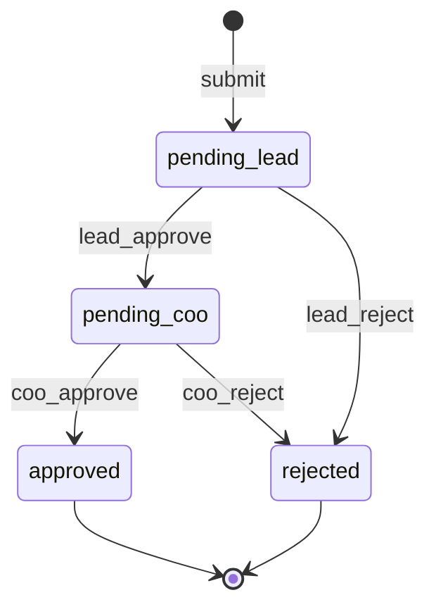

# HRM — Coding conventions, patterns và engineering rules

Ngày: 2026-10-16. **Trạng thái:** React và Mantine do người dùng chọn; các lựa chọn/policy bổ sung bên dưới là đề xuất để review trước implementation. Tài liệu không tự đổi semantics trong ADR đã chấp nhận hoặc đóng các câu hỏi nghiệp vụ G0.

Phạm vi: repo HRM, [requirement](HR_Web_Requirement_Tieng_Viet.md) và [implementation plan](superpowers/plans/2026-10-16-hrm-implementation.md). Chưa cài dependency, tạo frontend hay triển khai rule mới trong phiên soạn tài liệu này. Một quy tắc chỉ được gọi là tự động enforce khi đã có check tương ứng và bằng chứng chạy.

## 1. Stack đề xuất theo trách nhiệm

Không lấy phiên bản mới nhất của từng package rồi giả định tương thích. Ở task sở hữu, kiểm docs/peer dependencies khớp version, chọn exact versions, chạy install strict peers + build + integration smoke và cập nhật lockfile bằng pnpm. Các package `@mantine/*` dùng cùng release đã kiểm chứng. Chỉ cài package khi tính năng cần nó.

Runtime frontend khai báo trực tiếp ở `apps/web/package.json`; runtime backend ở `apps/api/package.json`; test/tool dependencies riêng nằm trong app sở hữu; root giữ tooling/tests chung workspace theo ADR 0015. Không dựa vào hoisting hoặc tạo package contracts/SDK để chia sẻ code. Browser không import source/dist/ORM types của API; HTTP DTO/schema theo contract được kiểm bằng fixtures/E2E, không đồng nhất entity với dữ liệu được phép trả.

| Phần             | Lựa chọn                                                                | Cách dùng và giới hạn                                                                                                                                                                                                                                           |
| ---------------- | ----------------------------------------------------------------------- | --------------------------------------------------------------------------------------------------------------------------------------------------------------------------------------------------------------------------------------------------------------- |
| UI               | React + TypeScript + Vite; Mantine đã được chọn                         | `@mantine/core`, `@mantine/hooks`; theme/token chung, CSS Modules; không thêm UI kit thứ hai. [Mantine/Vite](https://mantine.dev/guides/vite/)                                                                                                                  |
| Routing          | `react-router`, Data Mode                                               | Nested layouts, URL/search params, lazy routes, error boundary; không tạo thêm backend vào router. [React Router](https://reactrouter.com/start/data/installation)                                                                                              |
| Server state     | `@tanstack/react-query`                                                 | Query/mutation lifecycle, invalidation và cancellation; một owner cho mỗi tập dữ liệu. [Defaults](https://tanstack.com/query/latest/docs/framework/react/guides/important-defaults)                                                                             |
| Form             | `@mantine/form` + `zod`                                                 | Form validation/schema tại trust boundary; Mantine docs hiện có Standard Schema resolver, kiểm API đúng release đã pin. Không cài React Hook Form/Yup cùng chức năng. [Schema validation](https://mantine.dev/form/schema-validation/), [Zod](https://zod.dev/) |
| Ngày/giờ trên UI | `@mantine/dates` + `dayjs`                                              | Locale tiếng Việt, date-only string, không dùng parser UI làm parser có thẩm quyền. Mantine Dates dùng Day.js và giá trị ngày dạng string. [Dates](https://mantine.dev/dates/getting-started/)                                                                  |
| Feedback/upload  | `@mantine/notifications`; `@mantine/modals`/`@mantine/dropzone` khi cần | Notifications chỉ phản ánh kết quả server; dropzone không thay kiểm file phía server. [Packages](https://mantine.dev/guides/vite/)                                                                                                                              |
| HTTP client      | Browser `fetch`                                                         | Một client có xử lý status/CSRF/AbortSignal; không thêm Axios khi chưa có nhu cầu. [Query cancellation](https://tanstack.com/query/latest/docs/framework/react/guides/query-cancellation)                                                                       |
| Table            | Mantine Table + pagination/filter server                                | Dùng trước cho quy mô hiện tại; chỉ thêm headless table/virtualization khi nhu cầu và profiling chứng minh cần                                                                                                                                                  |
| API/schema       | NestJS/TypeORM hiện có; Zod cho DTO HR mới                              | Runtime input là `unknown`; API validate độc lập với UI. Không migrate toàn bộ auth cũ, không đưa Zod/framework vào authorization core                                                                                                                          |
| DB/time/auth     | PostgreSQL, runner/core/codecs hiện có                                  | Giữ fence, exact ACL và audit; không thay bằng ORM/framework authorization khác                                                                                                                                                                                 |
| XLSX             | `exceljs` phía server                                                   | Candidate cho T9: projection DTO → workbook; kiểm API/version/license và fixture read-back trước pin. Không import vào web bundle. [Project](https://github.com/exceljs/exceljs)                                                                                |
| DOCX             | `docxtemplater` khi HR chọn DOCX                                        | Candidate cho T10; cần chốt template/schema. Image module thuộc nhóm trả phí, phải xem license/budget trước khi chọn cho chữ ký ảnh. [Docs](https://docxtemplater.com/docs/)                                                                                    |
| PDF              | `pdf-lib` khi workflow cần xử lý PDF                                    | Candidate cho T10/T11; tạo/sửa PDF và nhúng ảnh, không mặc định là signing provider hoặc bộ chuyển DOCX → PDF. [Docs](https://pdf-lib.js.org/)                                                                                                                  |
| Backend tests    | `node:test` + Testcontainers hiện có                                    | Giữ suite backend; PostgreSQL thật cho race/ACL/fence, không dùng SQLite                                                                                                                                                                                        |
| Frontend tests   | Vitest + Testing Library                                                | Component/form/hooks; dùng Mantine provider và browser API mocks phù hợp, không thay API E2E bằng mock. [Mantine/Vitest](https://mantine.dev/guides/vitest/)                                                                                                    |
| Browser E2E      | Playwright                                                              | Login/role/approval/report/download với API thật và PostgreSQL disposable. [Best practices](https://playwright.dev/docs/best-practices)                                                                                                                         |

Không thêm Redux/Zustand, XState, workflow engine, Redis hay job queue ở baseline nếu chưa có trách nhiệm cụ thể cần chúng. Đây là giới hạn của đề xuất hiện tại, không cấm mở rộng sau bằng spec và bằng chứng.

## 2. Coding conventions

### 2.1. Chung và backend

- Tiếp tục `AGENTS.md`, strict TS, `noUncheckedIndexedAccess`, single quotes, trailing comma, LF; API relative imports `.js`, `import type` cho type-only. Frontend dùng TS browser/bundler config riêng, không phá NodeNext của API.
- File kebab-case và hậu tố trách nhiệm: `.service.ts`, `.helper.ts`, `.factory.ts`, `.types.ts`, `.schema.ts`, `.controller.ts`, `.migration.ts`; frontend bổ sung `.page.tsx`, `.component.tsx`, `.query.ts`, `.mutation.ts`. Module/domain số ít. Khi có hai file cùng vai trò, gom vào folder vai trò số nhiều trong đúng feature.
- Type/class/component PascalCase; function/variable camelCase; hook bắt đầu `use`; token bất biến UPPER_SNAKE_CASE. Named exports mặc định; tránh barrel che ownership hoặc tạo dependency cycle.
- Interface cho port/adapter có nhu cầu thay implementation; type/discriminated union cho DTO/state/result. Không tạo interface/generic repository cho mọi service chỉ để theo pattern.
- Public input/output có kiểu rõ; DTO/View riêng với ORM entity. Body/query/params, file metadata và provider callback bắt đầu `unknown`, schema allowlist/strict, sau đó kiểm invariant nghiệp vụ.
- Zod chỉ kiểm boundary/schema; scalar/date/timestamp phải theo semantics codec/helper sở hữu. Không dùng `Date.parse`/`z.coerce.date` làm fallback nới parser hoặc mất microseconds; ngày lịch phải hợp lệ thật, không chỉ khớp regex.
- Không `any`, assertion kép, non-null assertion hoặc `@ts-ignore` để né validation. ID UUID/string; bigint/numeric DB không round-trip qua JS number. Số phút là safe integer có bounds.
- Command có tên nghiệp vụ: `submit`, `decide`, `assign`, `adjustEntitlement`; không cho `update({...request.body})` sửa owner/role/version/state/permission.
- Service điều phối transaction/authorization/business rules; helper thuần tính slot/phép/chuyển trạng thái; SQL trong feature service/repository có trách nhiệm thực tế. Controller chỉ validate HTTP, gọi bound facade, map response/status.
- Clock/calendar/policy phiên bản phải explicit trong tính toán; không đọc timezone máy hoặc mutable global. Không mutate manifest/declarations/query cache/props dùng chung.
- Await/return Promise; background work phải có owner/durability/cleanup. Không catch rồi trả success/allow; không dùng `void` như cơ chế quản lý lỗi.
- Comments giải thích invariant/lý do; giới hạn chủ động dùng `shortcut: ...` theo quy tắc repo. Không dùng shortcut để bỏ authorization hoặc atomicity.

### 2.2. React và Mantine

Token, bố cục, trạng thái màn hình, a11y và cách viết chữ: [hệ thống thiết kế](hrm-ui-design-system.md); quy tắc riêng app: `apps/web/AGENTS.md`.

- Tổ chức theo feature: `employee/`, `work-request/`, `leave/`…; `app/` sở hữu providers/router/theme; `infrastructure/` sở hữu HTTP client. Không có thư mục `utils`/global store làm nơi chứa mọi nghiệp vụ.
- Page sở hữu route và kết nối query/mutation; component tập trung presentation/form; hook chỉ tách khi có lifecycle hoặc logic dùng lại. Không tạo component wrapper chỉ để đổi tên Mantine Button/Input.
- Một MantineProvider/theme trung tâm; dùng token cho spacing/color/font, CSS Modules cho styles của feature; import styles core trước extensions theo docs. Không override class hash nội bộ của Mantine. [Setup](https://mantine.dev/guides/vite/)
- `AppShell` cho layout, Table cho danh sách, Modal/Drawer cho tác vụ phù hợp, Stepper/Timeline cho tiến trình và lịch sử; disabled/hidden là UX, không phải security boundary.
- Form tiếng Việt có label/error rõ, keyboard focus, loading/empty/error states; không chỉ dùng màu để phân biệt kết quả. Buttons tác động dữ liệu hiển thị pending và chống click đôi ở UI.
- Form lớn ưu tiên uncontrolled mode, lấy giá trị hiện hành theo API đúng version, không đọc `form.values` như nguồn live trong uncontrolled mode. Không ghi đè bản nháp đang sửa khi query refetch; đổi record phải xử lý dirty form. [Uncontrolled form](https://mantine.dev/form/uncontrolled/)
- Render thuần, không gọi mutation trong render/Effect để gửi đơn hoặc duyệt; không sửa props/state trực tiếp. Effect chỉ dùng để đồng bộ với hệ thống ngoài, có cleanup. [React purity](https://react.dev/reference/rules/components-and-hooks-must-be-pure)
- Local state cho modal/tab; URL cho filter/sort/page không nhạy cảm; Mantine Form cho bản nháp; TanStack Query cho DTO từ server. Không sao chép server state sang Context/global store.
- Không đưa CCCD/MST/lý do nghỉ/token vào URL, localStorage, analytics hay error toast. LocalStorage chỉ dành preference không nhạy cảm như color scheme nếu cần.

## 3. Routing, server state và HTTP contract

Đề xuất `createBrowserRouter` + nested layout, lazy route theo feature và route error boundary. Router sở hữu navigation/search params; TanStack Query sở hữu cache dữ liệu server. Loader nếu dùng chỉ chuẩn bị session hoặc gọi cùng query client, không giữ cache thứ hai. Mutations nghiệp vụ dùng một đường qua query mutation layer; không vừa router action vừa hook mutation cho cùng thao tác.

1. Query key chứa namespace phiên người dùng và mọi filter/sort/page/cutoff ảnh hưởng kết quả. Không dùng query key chứa secret/PII. Không reuse cache người A cho người B.
2. HTTP client nhận AbortSignal, truyền xuống fetch, kiểm response status và parse DTO; API error trả `{ statusCode, code }`, `code` là key locale `error.*` của web từ tập đóng (root `AGENTS.md` §Locale và mã lỗi), không trả message hiển thị. Abort request phía browser không chứng minh server đã rollback.
3. Query GET có retry hữu hạn cho lỗi transient; auth/400/403/404 và 429 không retry tự động. Mutation submit/approve/sign mặc định không tự retry; nếu retry sau timeout, giữ cùng idempotency key và payload.
4. Không optimistic-update kết quả duyệt, số dư phép/công hoặc trạng thái ký. Chỉ hiển thị thành công sau server commit; network outcome chưa rõ phải tra trạng thái/replay idempotent, không tự báo thất bại chắc chắn rồi tạo thao tác mới.
5. Mutation thành công invalidate request/inbox/leave/attendance/report liên quan. Điều chỉnh lịch/quyền cũng invalidate dữ liệu phụ thuộc. Invalidation là UX, không thay recheck quyền ở API.
6. Logout/session expired: hủy in-flight queries, clear protected cache và bản nháp PII; đổi phiên tạo namespace/lifecycle cache mới để late response không nạp lại dữ liệu vào UI mới. Có browser test tài khoản A → logout → B và request cũ trả chậm.
7. Cache chỉ in-memory, không persist HR data vào storage/service worker. `staleTime` điều khiển độ mới hiển thị, không là authorization TTL. Không hứa cache ở tab đang mở bị xóa tức thời khi quyền bị thu hồi nếu chưa có invalidation channel; server luôn kiểm quyền request mới.
8. HTTP cache của response HR/download dùng policy private/no-store được kiểm ở deployment; CDN/service worker không cache theo URL chung giữa người dùng.

TanStack Query có mặc định refetch/retry/cache cần cấu hình chủ động; [docs defaults](https://tanstack.com/query/latest/docs/framework/react/guides/important-defaults) và [cancellation](https://tanstack.com/query/latest/docs/framework/react/guides/query-cancellation) là nguồn API. Các policy retry/cache trên là đề xuất riêng cho HRM, chưa có trong source.

## 4. Patterns nên áp dụng ở đâu

| Pattern                                 | Phần áp dụng                                                     | Quy tắc                                                                                                                                                            |
| --------------------------------------- | ---------------------------------------------------------------- | ------------------------------------------------------------------------------------------------------------------------------------------------------------------ |
| State machine                           | Work request, approval, contract generation/signing              | Một transition table/backend helper thuần; actor permission và business guards tách rõ; invalid transition reject, không gán state từ payload                      |
| Discriminated union + exhaustive switch | RequestKind/Decision/Result                                      | Input từng loại có field riêng, compiler giúp phát hiện thiếu case; runtime vẫn validate unknown                                                                   |
| Strategy                                | Validate/effect của annual/unpaid/WFH/late/early                 | Hàm/map typed cố định cho từng loại, không dynamic plugin từ admin/request. Quy tắc dùng chung ở đúng owner, không tạo class hierarchy rỗng                        |
| Factory tại composition root            | Wire codecs, bound HR facades, renderer/storage/signing adapters | Khởi tạo một lần với dependencies rõ; thiếu capability fail closed. Không có service locator/global mutable registry hoặc factory trong controller theo payload    |
| Facade/capability                       | HTTP feature → operations được bind                              | Tái sử dụng `.http-port.ts`/RuntimeModule; không trả DataSource/manager/raw authority cho handler                                                                  |
| Unit of Work                            | Decision + leave + attendance + audit                            | Runner hiện có là owner transaction; services nhận tx nội bộ, không mở nested independent transaction                                                              |
| Command/query separation                | Ghi đơn/duyệt so với list/report                                 | Tách operation/read DTO khi trách nhiệm khác; không cần Nest CQRS/event bus chỉ để đặt tên pattern                                                                 |
| Append-only ledger                      | Entitlement/use/reversal/adjustment                              | Unique effect ID, ngày hiệu lực, đối soát; hoàn bằng compensating entry. Không biến toàn hệ thống thành event sourcing                                             |
| Adapter/port                            | File generation/storage, signing, mail thật                      | Contract độc lập SDK; adapter cố định lúc boot; provider conformance + integration evidence                                                                        |
| Transactional outbox                    | Side effect mạng phải durable khi được yêu cầu                   | Event/intent cùng transaction, worker retry hữu hạn/idempotent; audit outbox hiện tại không dùng chứa recovery token/PII hoặc tùy tiện thay bằng hàng đợi hợp đồng |

### 4.1. Ví dụ state machine phê duyệt

Tên state dưới đây là đề xuất cho T0/T6, chưa phải API đã tồn tại. Diagram chỉ mô tả happy path và reject; cancel/edit/reopen cần chốt D06 trước khi thêm transition.

Transition helper chỉ trả next state hoặc typed rejection, không chạy SQL/network. Approval service mới kiểm actor/team/session, self-approval rule, expectedVersion, quota/số dư và commit effects. UI hiển thị state server trả về; không tự suy ra COO approved chỉ vì client đã chuyển Stepper.

Ở `pending_lead`, COO không được nhảy thẳng `approved`; ở `pending_coo`, Lead không được ghi đè quyết định cũ. Root bypass quyền vẫn giữ thứ tự/unique effect/quota, trừ khi có command nghiệp vụ ngoại lệ được spec riêng; không thêm `isRoot` để bỏ mọi guard. XState chỉ cân nhắc nếu có nhu cầu state lồng/parallel/timers phức tạp; thư viện không thay persistence/locking.

### 4.2. Ví dụ Factory

Đề xuất `createContractServices(dependencies)` trong composition/contract factory của T10 để nhận adapter renderer/storage/signing đã chọn và tạo services. Đây là tên minh họa, signature/types khóa trong spec T10. Request chỉ gửi templateId/documentId/type hợp lệ; không gửi module path, provider class, SQL, storage URL hoặc credential để factory tạo implementation mới.

Factory không tự đọc `.env` ở mọi feature, không tạo pool mỗi request và không silently thay signing provider bằng mock khi thiếu cấu hình. Lifecycle/shutdown/cleanup thuộc owner tạo tài nguyên.

## 5. Race condition và tính toàn vẹn dữ liệu

State machine giải quyết transition logic; optimistic version phát hiện dữ liệu cũ; pessimistic locks serialize việc kiểm/ghi quota; unique constraints/idempotency chống lặp. Không biện pháp nào một mình bao phủ toàn bộ flow.

**Đề xuất protocol HR cần ADR ở T2:** fence hiện có → resolve session/facts/authorize action → claim idempotency record → khóa employee ổn định → request(s) theo ID tăng dần → quota/leave buckets theo employee/period tăng dần → attendance/period → effects/audit → commit. Mọi writer điều chỉnh phép/công/đơn phải theo cùng protocol; nếu nhiều employee thì khóa employee theo ID tăng dần trước request. Identity flows giữ protocol riêng đã chấp nhận; không tự ép lock order HR lên chúng. Existing runner advisory serialization, nếu dùng, vẫn phải trước fence theo source.

Employee lock là đề xuất serialization đơn giản cho quy mô này; cần test lock waits và FK/trigger interactions trước chấp nhận ADR. Không dùng mutex trong memory vì nhiều API process không chia sẻ nó. Hai transaction cùng giữ shared application fence vẫn có thể race trên một nhân viên; domain locks vẫn cần.

| Tình huống                    | Cơ chế đề xuất                                                                                                                             | Test bắt buộc                                                                                    |
| ----------------------------- | ------------------------------------------------------------------------------------------------------------------------------------------ | ------------------------------------------------------------------------------------------------ |
| Duyệt cùng đơn hai lần        | Row lock + expectedVersion + conditional transition + unique stage decision                                                                | Hai DB connections dùng barrier: chỉ một lần transition/effect, bên còn lại replay hoặc conflict |
| Replay/mạng timeout           | Unique idempotency scope `(actor, action, key)`, bind target + normalized payload hash; effect/result commit cùng transaction              | Cùng key/payload trả kết quả tương ứng; khác payload reject; key của actor khác không đọc result |
| Hai đơn vượt WFH cap          | Khóa employee/quota bucket và check+increment trong transaction final approve                                                              | Tại boundary 4 lần theo D04, hai approvals cạnh tranh không vượt số hợp lệ                       |
| Bucket chưa tồn tại           | Unique `(employee, period)`, tạo bằng insert-on-conflict theo protocol rồi lock; không SELECT FOR UPDATE dòng không tồn tại để coi đã khóa | Hai requests đầu tháng/năm không tạo counter đôi hoặc vượt số dư                                 |
| Hai đơn ăn số phép cuối       | Khóa entitlement/balance bucket + invariant không âm + unique leave effect                                                                 | Tổng debit không quá available; audit/effect thất bại rollback decision                          |
| Trùng khoảng nghỉ/WFH         | Serialize theo employee, kiểm interval cùng transaction; FK/check/unique và exclusion constraint nếu mô hình yêu cầu                       | Hai submissions hoặc approvals trùng một phần không cùng commit sai semantics D06                |
| HR sửa version cũ             | Compare expectedVersion ở UPDATE, kiểm affected row, trả conflict an toàn                                                                  | UI không overwrite bản mới và vẫn giữ bản nháp để người dùng đối chiếu                           |
| Team/quyền đổi khi đang duyệt | Facts change exclusive fence + revision; approval recheck trong shared fence                                                               | Sau revoke commit, transaction mới không dùng quyền cũ; kiểm cả affected set                     |
| Hủy/đảo đã duyệt              | Command riêng theo D06, compensation ledger/công, unique reversal reference                                                                | Retry hủy không hoàn phép hai lần; close-period theo D07 được tôn trọng                          |
| Hai signing callbacks         | Verify authenticity + unique provider event + expected document hash/version                                                               | Replay callback không ký/lưu hai lần; document thay đổi thì không attach signature cũ            |
| Retry deadlock/timeout        | Runner retry hữu hạn, callback chỉ DB effects có thể rollback/idempotent                                                                   | Không gửi mail/render/upload trong callback bị chạy lại                                          |

Các unique/FK/CHECK đặt ở DB, không chỉ precheck UI/service. Không dùng CHECK chứa query bảng khác để chứng minh hạn mức tổng. PostgreSQL có [row locks/deadlocks](https://www.postgresql.org/docs/18/explicit-locking.html) và [constraints](https://www.postgresql.org/docs/18/ddl-constraints.html); protocol HR ở trên là thiết kế đề xuất cần kiểm bằng integration test, không phải tính năng PostgreSQL tự cung cấp.

Recheck authorization trước đọc/replay idempotency result; không trả PII cũ cho actor đã mất quyền. Idempotency retention, payload fingerprint và response projection phải khóa trong spec; không giữ token/request body thô trong bảng này. Retry sau transaction đã rollback không được để lại success marker riêng.

## 6. Security rules

1. **Authorization:** API kiểm action đích và record scope cho list/detail/count/export/write bằng AST hiện có; không suy update từ read, không lọc sau pagination. Team Lead/COO/HR là grants/boundaries, không rank. Role route/menu guard chỉ phục vụ UI. [OWASP authorization](https://cheatsheetseries.owasp.org/cheatsheets/Authorization_Cheat_Sheet.html)
2. **Session/CSRF:** giữ cookies HttpOnly/Secure theo môi trường, origin allowlist và token header. CSRF token lấy từ JSON `/api/auth/csrf`, không cố đọc cookie HttpOnly bằng JS. Frontend/API cùng origin; proxy local giữ headers theo config. Không nới CORS/Origin để né test. [CSRF guidance](https://cheatsheetseries.owasp.org/cheatsheets/Cross-Site_Request_Forgery_Prevention_Cheat_Sheet.html)
3. **Trust boundary:** không tin actor/role/team/state/version từ client; version chỉ concurrency precondition. Allowlist fields, reject unknown security fields; không mass assignment. Provider/webhook cần schema/authenticity/replay checks riêng.
4. **PII:** projection theo capability trước query; không fetch tất cả rồi chỉ hide column. Employee profile cơ bản tách khỏi CCCD/MST và contract/signature access; ngày sinh/lý do nghỉ theo D08. Root vẫn đọc được qua bypass hiện có; giữ account vận hành riêng và audit, không hứa field ACL hạn chế Root.
5. **Sensitive actions:** Root cần fresh-auth khi và chỉ khi policy của action có `fresh@1`, như IAM (ADR 0022). Đề xuất thêm fresh-auth cho IAM ở thao tác quyền, điều chỉnh phép/công và ký hợp đồng bằng permission policy `fresh@1`; đây là thay đổi cần T0/T2 chấp nhận, không coi hiện đã áp dụng mọi write.
6. **XSS/CSP:** render lý do/tên/template metadata bằng text; không `dangerouslySetInnerHTML` với input HR. Nếu cần rich text, tách spec sanitization. CSP phải kiểm với CSS/portal/style của Mantine: nonce cho style tags không tự cho phép mọi inline style attributes; test thực tế thay vì bật `unsafe-inline`/`unsafe-eval` toàn cục để hết lỗi. [MantineProvider nonce](https://mantine.dev/theming/mantine-provider/)
7. **Upload:** allowlist loại/size, kiểm signature bytes và decode, generated filename, private storage; không tin extension/MIME/path từ client. Chặn archive expansion/zip bomb ở DOCX parser; không resolve URL/path/remote assets từ template. Parser/render có time/memory budget và owner cleanup. [OWASP upload](https://cheatsheetseries.owasp.org/cheatsheets/File_Upload_Cheat_Sheet.html)
8. **Signing/download:** exact document hash/version, actor được phép, callback verified; file download authorize lại, không public bucket. Presigned URL nếu chọn phải spec expiry/revocation: link đã phát có thể còn hiệu lực sau thu hồi quyền, không hứa immediate revoke khi provider không hỗ trợ.
9. **Excel:** text từ người dùng luôn cell text, không formula/hyperlink ngoài allowlist; exports không âm thầm thêm field nhạy cảm. Test các prefix `=`, `+`, `-`, `@`, Unicode và read-back bằng reader thực tế.
10. **Audit/log/error:** effect/audit atomic; request ID hữu hạn theo log correlation, metric labels không có ID/raw URL/PII. Audit không chứa lý do nghỉ/CCCD/MST/token/file body. Client nhận error code/status an toàn; raw DB/stack chỉ xử lý theo logging đã redact. Absent/hidden cùng shape theo contract.
11. **Credentials/dependencies:** API không giữ migration/bootstrap secrets; frontend env đều xem là public. Không commit `.env`; pin deps và kiểm advisories/license khi chọn/update; không nới strict peers để cài được. Không tự thêm recovery/sink giả trả success.

## 7. Performance và resource rules

### 7.1. Frontend

- Lazy-load route reports/contracts; Excel/document libraries ở server, không nằm trong initial bundle. Đo bundle và profile trước quyết định memo/virtualization; không `memo/useMemo/useCallback` mọi nơi.
- Server pagination/filter/sort; debounce search có bounds, cancel GET cũ bằng AbortSignal, query key tránh response cũ ghi vào filter mới. Đề xuất debounce 300 ms, cần kiểm UX; không trì hoãn mutation bằng debounce.
- Form dùng subscription đúng field thay vì render cả cây theo từng phím; không query toàn bộ catalog mỗi render. Không poll vô hạn inbox/batch; polling có interval/stop/max duration theo spec nếu thực sự cần.
- Tái sử dụng query cache trong một phiên, invalidate đúng dependencies; không cache authorization decision ở frontend/server để bỏ recheck revision.

### 7.2. API/database/files

- Giữ giới hạn gateway hiện có: default page 20, max 100, max offset 10000, max filter nodes 32 (`authorization/product-data.gateway.ts`). Không tự thêm keyset pagination/cache khi chưa có đo và thiết kế scope tương ứng.
- Runner hiện cap transaction 2000 ms, lock timeout 1000 ms, retry tối đa 2 (`database/product-transaction.runner.ts`); không tăng timeout để che render/network/query lớn trong fence. Đây là cấu hình hiện có, không là cam kết latency end-to-end.
- Không N+1; select đúng projection, JOIN/aggregate theo quyền; query/index thay đổi vì performance cần EXPLAIN ANALYZE trên disposable workload đại diện, cùng workload trước/sau. Batch không vượt trust/transaction scope.
- `READ COMMITTED` không cho multi-query report snapshot cố định chỉ vì cùng transaction. Ưu tiên một statement/CTE có scope; nếu cần snapshot/batch lớn phải spec cơ chế riêng và recheck quyền lúc phát artifact, không tự đổi isolation của runner.
- Không giữ fence trong lúc render Excel/PDF, hash, upload, gọi signing/email. Chụp DTO/version được phép trong transaction ngắn, render bên ngoài, rồi recheck quyền/version để publish metadata hoặc giao file theo contract.
- Mọi export range/rows/output bytes, upload bytes/pixels/archive expansion, batch size/concurrency/retry/timeout đều có hard bound server; không `Promise.all` trên collection không giới hạn. Missing/invalid budget fail config/task, không mặc định unbounded.
- T0/T9/T10 phải lập budget cụ thể trước code. Đề xuất workload đo: 50 nhân viên, 24 tháng, 24000 đơn synthetic, 10 phiên thao tác đồng thời; đây là workload dự kiến, chưa chạy và không suy ra SLO từ quy mô này.
- Đo p50/p95/p99, error/timeout rate, pool wait/lock hold/lock wait, query count, RSS và export duration/file bytes. Chốt SLO với owner sau baseline; không gọi nhanh hơn/production-ready chỉ từ unit hoặc fixture nhỏ.
- Không thêm permission cache, TTL thay revision, pool mới, fence splitting hay worker khi chưa có bằng chứng và invalidation/lifecycle/durability design.

## 8. Tests và enforcement dự kiến

| Nhóm                  | Kiểm tự động cần có                                                                                                               | Task          |
| --------------------- | --------------------------------------------------------------------------------------------------------------------------------- | ------------- |
| Code conventions      | ESLint/Prettier hiện có; bổ sung TSX scope, React Hooks rules và browser TS config, không vô hiệu rule API                        | T1            |
| Boundaries            | ESLint + negative module-boundary cases cho feature HR và controller facades; forbidden core imports vẫn bị chặn                  | T2/T3         |
| UI/forms              | Vitest/Testing Library: loading/error/dirty form, Mantine inputs/portals, schema negative cases, query cache đổi account          | T1/T3/T5      |
| State machine         | Table-driven transitions cho mọi state × event, guard reject và exhaustive RequestKind cases                                      | T5/T6         |
| Integrity/concurrency | PostgreSQL multi-connections + deterministic barriers, constraints, rollback/audit failure, revoke, first bucket và replay        | T2/T6/T7/T8   |
| Browser security      | Playwright với API thật: CSRF/origin, 401/403/404 projection, account switch, stale version, approve timeout, restricted download | Theo từng mốc |
| Reports/contracts     | XLSX read-back/formula text, document hash/version, batch partial failure, malicious upload và provider callback                  | T9/T10/T11    |
| Performance           | Workload/measurement reproducible; query plans và before/after khi claim cải thiện                                                | T9/T12        |

Backend sở hữu tests/fixtures/runner/env tại `apps/api/test`, `apps/api/tools`, `apps/api/.env.*` và build/test configs trong app; root orchestration không hardcode test globs của app. Backend giữ `node:test`; không chuyển runner toàn repo để dùng Vitest cho UI. Unit test Mantine có test provider theo docs; browser E2E dùng UI/provider production thật, không bật chế độ test bỏ portal/transition để làm pass. CI chỉ thêm scripts sau khi runner/source thật đã có.

**PR/review checklist đề xuất:** scope nhỏ; spec/ADR không mâu thuẫn; ma trận quyền/PII đầy đủ; validation bounds; lock order/idempotency/atomic audit; migrations + probes + manifest; invalid transitions/races/revocation; UI loading/error/dirty state; không PII/secret/generated artifacts; ghi lệnh chạy thật và checks chưa chạy. Không auto-commit/deploy.

## 9. Áp vào kế hoạch

- T0: review tài liệu này; ghi các quyết định được chọn vào spec/ADR, chốt budgets và business G0. Không dùng tên pattern để tự quyết định semantics còn thiếu.
- T1: React/Mantine/Vite/router/query/form/theme + UI test toolchain; pin versions/peer compatibility và setup provider/styles.
- T2–T3: capability/PII projection, DI/factory, schema và boundary tests; ADR lock protocol trước HR mutations.
- T4–T8: helper thuần, state machine/strategy, minute integer, employee/quota locks, expectedVersion, ledger/idempotency; concurrency tests thật.
- T9: ExcelJS candidate, scoped snapshot/render tách transaction, export bounds và read-back tests.
- T10–T11: adapters/factory/batch state machine, license/provider selection, file/signature controls và durability khi cần.
- T12: full checks/UAT/measurement/backup-restore; chỉ ghi enforce hoặc pass khi có bằng chứng hiện tại.
